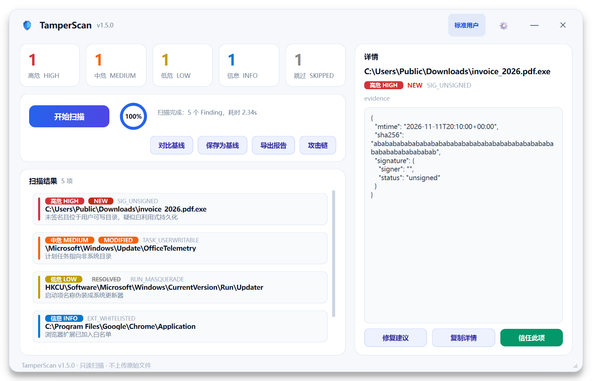
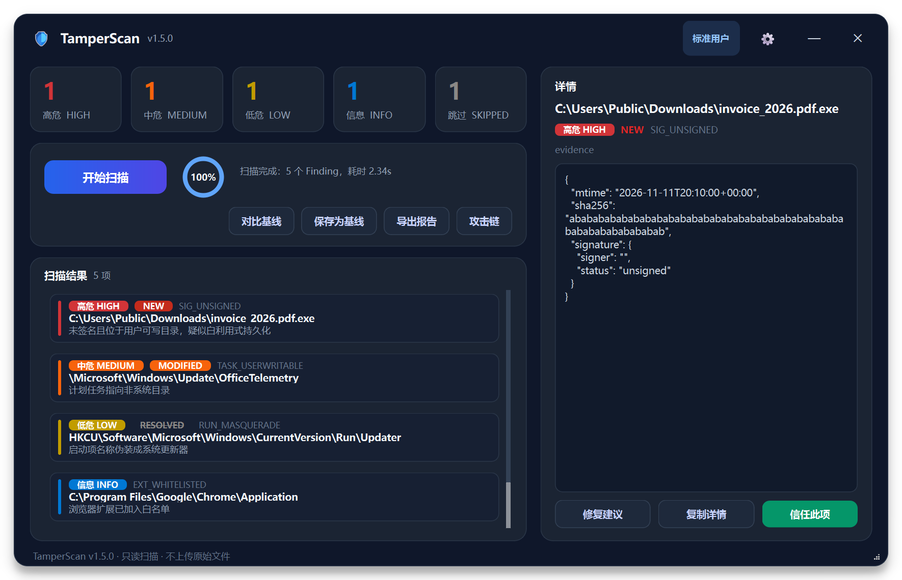

# TamperScan

[](https://github.com/EnkiduX325/tamper_scan/actions/workflows/ci.yml)
[](LICENSE)
[](CHANGELOG.md)

> ⚖️ **双轨授权**：开源使用遵循 **AGPL-3.0**（个人使用、内部安全评估等免费）；闭源商业集成、随商业产品分发或需免除 AGPL 源码开放义务时，须购买商业授权（见 [LICENSE-COMMERCIAL.md](LICENSE-COMMERCIAL.md)）。贡献者请阅读 [CLA.md](CLA.md)。

开箱即用的 Windows 防篡改扫描器：直接运行即可扫描持久化位置与浏览器配置，输出按严重等级排序的可疑项报告。不依赖预先建立的基线，判定依据是启发式规则 + 数字签名信任链 + 内容特征 + 行为特征。

> ⚠️ 免责声明：本工具仅用于个人设备或已获得明确授权的安全评估。请勿用于未经授权的扫描。使用者应遵守当地法律法规，作者不对滥用行为承担责任。





- 版本：`1.5.0`（唯一来源：[core/version.py](core/version.py)）
- **V1.5 更新（2026-11-11）：PyQt6 商业级 UI + 多层级误报治理 + 弱网非阻塞交互**：
  - **PyQt6 全量重构**：物理删除 Tkinter `gui.py`，新增 [gui_qt.py](gui_qt.py) 作为唯一 GUI 入口（`python main.py --gui`）：无边框窗口 + 自定义拖拽 + QGraphicsDropShadowEffect、浅色/暗黑 QSS 双主题、5 张圆角统计卡、QPainter 自绘环形进度、自定义横幅结果列表、右侧 evidence 详情面板；
  - **绝不阻塞**：扫描与更新检查全部在 `QThread` 中执行并通过 `pyqtSignal` 回主线程；扫描异常弹窗兜底、支持取消；启动 5 秒后静默检查更新（3 秒超时 + HTTPS + 单调时钟截止时间）；
  - **误报治理闭环**：联合指纹白名单（`rule_id + signer_contains + target_prefix`，默认 90 天到期自动失效）、系统更新 1 小时时间窗 `BENIGN_UPDATE`、攻击链反模式库扩充至 5 条；
  - **信任与弱网**：GUI「信任此项」写入用户 `config.json` 并可匿名上报（用户名/完整路径脱敏后进入本地 `pending_report` 队列，恢复网络后发送）；
  - **测试**：**1102 条**（含 PyQt6 offscreen GUI 测试与 C2/C3 回归），`python -m pytest -q -W error` 全绿。
- **V1.4 更新（2026-11-11，历史）：信任边界、基线归一化与攻击链关联**：
  - **autorunsc64 信任边界**：执行 Sysinternals `autorunsc64.exe` 前强制校验微软签名（可选 SHA256 白名单），不可信则 `SKIPPED / AUTORUNS_UNTRUSTED_BINARY`，**绝不执行不可信二进制**；
  - **基线引擎增强**：`normalize_target` 严格归一化（环境变量展开、`\\?\` 长路径前缀、Sysnative 映射、8.3 短名解析、大小写/尾随空格），索引写入 `normalized_key`；对比状态扩展为七种（新增 `BENIGN_UPDATE`），支持良性版本前进豁免 `--treat-version-bump-as-benign`；
  - **攻击链关联**：新增 `rules/attack_chain.json`（固定剧本 + 反模式）与 [core/correlator.py](core/correlator.py)，CLI 提供 `--campaign` / `--campaign-shadow` / `--fail-on-campaign high`；HTML 增加纯 CSS 攻击链时间线（V1.4 Tkinter GUI 曾提供攻击链视图，V1.5 已随 GUI 重构暂由 HTML/CLI 呈现）；反模式自动抑制误报，**绝无自由组合**；
  - **CLI 容错**：新增 `--fail-on-skipped`（存在 SKIPPED 时退出码 `3`）、`--save-baseline`/`--baseline` 互斥、基线未含哈希时的 WARN、`--quiet` 下 SKIPPED WARN；
  - **core 拆分**：[core/utils.py](core/utils.py) 拆分为 `core/paths.py` / `core/acl.py` / `core/subprocess_util.py` / `core/whitelist.py`，`core.utils` 保留向后兼容 shim；模块总数仍 **20**；
  - **协议双轨**：AGPL-3.0（个人/内部免费）+ 商业授权（闭源商用），新增 [LICENSE-COMMERCIAL.md](LICENSE-COMMERCIAL.md) 与 [CLA.md](CLA.md)，详见 [§11](#11-许可协议license)；
  - **向后兼容**：不传 V1.4 新参数时，扫描行为 / JSON / 退出码与 V1.3 完全一致；
  - 单元测试扩展至 **700 条**（V1.4 起，含 autorunsc 信任 / CLI 容错 / correlator / 基线增强 / core 拆分；`python -m pytest -q` 全绿）。
- **V1.3 更新（2026-11-11，历史）：基线对比（Baseline Diff）**：
  - 新增 [core/baseline.py](core/baseline.py) 基线对比引擎：按 `(target, rule_base)` 主键输出 **NEW / RESOLVED / ESCALATED / DOWNGRADED / MODIFIED / UNCHANGED** 六种状态，`fingerprint` 自动剔除 `timestamp` / `pid` 等易变字段；
  - CLI 新增 `--save-baseline PATH`（保存基线）、`--baseline PATH`（对比基线）、`--fail-on-new`（存在 NEW 的 HIGH/MEDIUM 时强制退出码 `2`）、`--hash-targets`（HIGH/MEDIUM 本地文件写入 `evidence.sha256`），详见 [§3.1](#31-基线对比v14)；
  - 新增“签名有效但文件哈希改变，高度疑似被篡改”检测：基线与当前签名都 `valid` 但 SHA256 不同 → 判定 `MODIFIED` 并强制 `HIGH`；
  - 报告：启用 `--baseline` 时 JSON 顶层 `baseline{path,generated_at}`、每条 Finding 带 `diff_status`；HTML 增加基线对比统计、状态徽章（NEW 红 / MODIFIED 橙 / RESOLVED 灰+删除线）与「⚠️ 此项目与基线相比发生变化」横幅；
  - GUI 新增「对比基线」「保存为基线」按钮、结果列表「状态」列与「对比基线: <文件名>」+ X 取消对比；
  - **向后兼容**：不传上述新参数时，扫描行为 / JSON 结构 / 退出码与 V1.2 完全一致；
  - 单元测试扩展至 **426 条**（V1.3 起，含基线对比测试；完整通过 `python -m pytest -q`）。
- **V1.2 更新（2026-11-11，历史）**：
  - 新增第 20 个模块 `persistence_ext`「冷门持久化扩展点」（Netsh Helper / TimeProvider / Print 处理器与监视器 / Active Setup / AppCompat Shim / SilentProcessExit / WER LocalDumps / CMD Autorun / SCRNSaver 共 10 个检测点），模块总数 **20**，规则清单见 [§9.2](#92-v12-新增变更规则清单)；
  - `lsa_appinit` 增加 **Winlogon / AutoAdminLogon** 检测（8 条规则，覆盖 Shell / Userinit / GinaDll / AppSetup / TaskMan / Notify 篡改与明文自动登录）；
  - `service` 泛化 **ServiceDll** 校验（`SVC_SERVICEDLL_TAMPER` / `SVC_SERVICEDLL_ABSENT`，与 RDP 的 `ServiceDll` 检测自动去重合并）；
  - 新增**只读修复建议**（`rules/remediation.json`）：JSON / HTML / GUI 展示建议处理命令，**扫描器绝不执行任何命令**；
  - 单元测试扩展至 **312 条**（V1.2 起，`python -m pytest -q`）。
- **V1.1 新增 4 个高级威胁检测模块**（Tarrask 计划任务隐藏、WFP / EDR Silencer 持久化过滤器、
  凭证与 RDP 后门、未加引号服务路径）；详见 [§9.1](#91-v11-新增模块与规则清单)
- 支持：Windows 10 / 11（x64），Python 3.10+
- 单次扫描、无云端依赖；外部工具仅 Sysinternals `autorunsc64.exe`（缺失自动降级）

> 外部工具提示（重要）：本仓库不包含 Sysinternals 的 `autorunsc64.exe`（其许可不允许第三方再分发），请按 [tools/README.txt](tools/README.txt) 从微软官方下载后放入 `tools/`。若缺少该工具，Autoruns 模块会自动跳过（`SKIPPED`），扫描继续，其余模块不受影响（当前共 20 个模块）。**信任边界**：V1.4 起执行前会强制校验该二进制的微软签名（可选 SHA256 白名单），不可信时报 `SKIPPED / AUTORUNS_UNTRUSTED_BINARY` 并**拒绝执行**。

提供两种使用形态：

- GUI 版 `dist\tamper_scan_gui.exe`：双击即用、无控制台窗口，适合普通用户日常扫描与直观查看结果（图形界面详见 [§2](2-图形界面gui)）。
- CLI 版 `dist\tamper_scan.exe`：适合自动化、计划任务、脚本调度或 CI 流水线，通过退出码判断结果。

---

 1. 快速开始

 方式 A：图形界面（推荐普通用户）

```bat
dist\tamper_scan_gui.exe     :: 双击，或在命令行启动（无控制台窗口）
python main.py --gui         :: 源码方式启动（PyQt6）
python gui_qt.py             :: 等价的直接启动
```

界面操作：点击「开始扫描」→ 查看左侧结果列表与右侧详情 → 点击「导出报告」保存 HTML/JSON。

 方式 B：命令行（适合自动化 / CI）

```bat
dist\tamper_scan.exe --scan
dist\tamper_scan.exe --scan --format both --output reports\scan
python main.py --scan --quiet --format both --output C:\reports\tamper

:: 基线对比（V1.3）：首次保存基线，之后每次扫描对比
dist\tamper_scan.exe --scan --save-baseline C:\baseline\base.json
dist\tamper_scan.exe --scan --baseline C:\baseline\base.json --fail-on-new

:: 攻击链关联（V1.4）：固定剧本后处理 + 影子模式 + 高置信度时强制告警
dist\tamper_scan.exe --scan --campaign --fail-on-campaign high
dist\tamper_scan.exe --scan --campaign-shadow --format json --output reports\shadow

:: 容错（V1.4）：存在未检查项时以退出码 3 提醒（未检查 ≠ 安全）
dist\tamper_scan.exe --scan --quiet --fail-on-skipped
```

 方式 C：源码运行

```bat
python -m pip install -r requirements.txt
python main.py --scan        :: CLI
python main.py --gui         :: GUI（PyQt6）
```

> `requirements.txt` 是运行依赖；打包 exe 另需 `python -m pip install -r requirements-build.txt`。
> GUI 依赖 `PyQt6`（V1.5 起唯一界面）；打包 exe 另需 `python -m pip install -r requirements-build.txt`。
> `skrapa` 为可选依赖（缺失时内存扫描返回 `SKIPPED / MEMORY_SKIPPED`），默认在 `requirements.txt` 中注释，需要内存扫描时自行 `pip install skrapa`。

 以管理员身份运行可得到完整结果

默认不强制提权（exe 无 UAC manifest，GUI 与 CLI 行为一致），标准用户可以正常使用大部分功能，但以下检查按设计降级为 `SKIPPED`（不是"没问题"）：

| 检查 | 标准用户行为 | 原因 |
|---|---|---|
| 进程内存 YARA（`MEMORY_`） | `SKIPPED / MEMORY_ACCESS_DENIED` | skrapa 读取进程内存前必须启用 `SeDebugPrivilege`，标准用户对任何进程（含自己）都会 `TokenPrivilegeError` |
| BITS 全用户作业（`BITS_`） | `SKIPPED / BITS_ACCESS_DENIED`，自动降级只查当前用户 | `Get-BitsTransfer -AllUsers` 需要管理员 |
| Defender 排除项（`POLICY_`） | `SKIPPED / POLICY_ACCESS_DENIED` | `Windows Defender\Exclusions` 键对标准用户拒绝访问 |
| 计划任务隐藏检测（`TASK_HIDDEN_`） | `SKIPPED / TASK_HIDDEN_ACCESS_DENIED` | `Schedule\TaskCache\Tree` 键对标准用户拒绝访问（Tarrask 检测需管理员） |
| WFP 持久化过滤器（`WFP_`） | `SKIPPED / WFP_ACCESS_DENIED` | `BFE\Parameters\Policy` 键对标准用户拒绝访问（EDR Silencer 检测需管理员） |

需要完整结果时：

- GUI：右键 `tamper_scan_gui.exe` → 以管理员身份运行；
- CLI：以管理员身份打开终端，再执行 `python main.py --scan` 或 `dist\tamper_scan.exe --scan`。

权限降级与界面提示详见 [§2.2](22-权限提醒与降级说明)。

---

 2. 图形界面（GUI）

V1.5 起 GUI 使用 **PyQt6** 全量重写（[gui_qt.py](gui_qt.py)），旧 Tkinter `gui.py` 已物理删除；扫描核心与 CLI 完全复用 [core/scanner.py](core/scanner.py)，因此两种形态的模块顺序、白名单、去重排序、异常降级结果完全一致。界面支持浅色/暗黑双主题（QSS）、无边框拖拽与阴影，扫描/更新检查全部在后台 `QThread` 执行，主线程永不阻塞。

启动方式：`python main.py --gui`、`python gui_qt.py`，或双击 `dist\tamper_scan_gui.exe`。

 2.1 两种形态对比

| 维度 | GUI 版 `tamper_scan_gui.exe` | CLI 版 `tamper_scan.exe` |
|---|---|---|
| 启动方式 | 双击即用（`--windowed`，无控制台窗口）；也可 `--gui` | 终端 / 计划任务 / CI 脚本 |
| 结果展示 | 5 张彩色统计卡 + 横幅结果列表 + 详情面板 + 环形进度 | 控制台逐条打印 + JSON/HTML 报告文件 |
| 自动化 | 不适合（交互式） | 适合：`--quiet` + 退出码 `2/1/0` |
| 报告导出 | V1.5 暂未内置导出按钮（可用 CLI 的 `--format` 生成） | `--format json\|html\|both --output PATH` |
| 基线对比 | 「对比基线」/「保存为基线」按钮；结果行显示 NEW/MODIFIED 等状态 | `--baseline` / `--save-baseline` / `--fail-on-new` / `--hash-targets`（见 [§3.1](#31-基线对比v14)） |
| 攻击链关联 | 暂由 CLI/HTML 报告呈现，GUI 后续版本接入 | `--campaign` / `--campaign-shadow` / `--fail-on-campaign high`（见 [§3.2](#32-攻击链关联v14)） |
| 典型用户 | 普通用户日常巡检、人工确认 | 运维/安全团队批量调度 |
| 权限完整度 | 取决于是否以管理员身份运行（见 2.2） | 同左 |

 2.2 权限提醒与降级说明

以管理员身份运行可获得最完整的结果：Defender 排除项、BITS 全用户作业、进程内存扫描（`MEMORY_`）、计划任务隐藏检测（`TASK_HIDDEN_`）、WFP 持久化过滤器检测（`WFP_`）都需要管理员权限。

标准用户（未提权）时，以下五类检查会降级为 `SKIPPED`：

| 降级项 | 典型 rule_id | 界面表现 | 说明 |
|---|---|---|---|
| 进程内存 YARA | `MEMORY_ACCESS_DENIED` / `MEMORY_SKIPPED` | 灰色 `SKIPPED` 行 + 灰色统计卡片计数 | skrapa 需 `SeDebugPrivilege` |
| BITS 全用户作业 | `BITS_ACCESS_DENIED` | 灰色 `SKIPPED` 行 | 自动降级只查当前用户 |
| Defender 排除项 | `POLICY_ACCESS_DENIED` | 灰色 `SKIPPED` 行 | 注册表排除项键需要管理员 |
| 计划任务隐藏检测 | `TASK_HIDDEN_ACCESS_DENIED` | 灰色 `SKIPPED` 行 | `Schedule\TaskCache\Tree` 键需要管理员 |
| WFP 持久化过滤器 | `WFP_ACCESS_DENIED` | 灰色 `SKIPPED` 行 | `BFE\Parameters\Policy` 键需要管理员 |

> 顶部权限徽章会显示当前是「管理员」还是「标准用户」；`SKIPPED` 是权限不足时的安全降级——扫描器明确告诉你「这一项没有检查」，而不是把未检查项当作干净。

 2.3 界面功能速览

- **顶部栏**：Logo + `TamperScan v1.5.0`、当前权限圆角徽章、设置齿轮、最小化/关闭；整条标题栏支持鼠标拖拽移动（无边框窗口 + 四周阴影）。
- **统计卡**：HIGH 红 / MEDIUM 橙 / LOW 黄 / INFO 蓝 / SKIPPED 灰，大号加粗数字；扫描/基线对比后实时刷新。
- **控制栏**：大号「开始扫描」按钮（扫描中变为「取消扫描」）、QPainter 自绘环形进度条、扫描状态与模块进度、「对比基线」「保存为基线」。
- **结果列表**：`QListWidget` 自定义横幅行——左侧 4px 等级色块、`NEW`/`MODIFIED`/`BENIGN_UPDATE`/`RESOLVED` 状态、等级 chip、规则号、target 与摘要；点击行联动右侧详情。
- **详情面板**：完整 `target`（长路径自动折行）、等级/状态/规则、等宽字体格式化 `evidence` JSON；底部「复制详情」「信任此项」；RESOLVED 项自动禁用信任。
- **信任闭环**：「信任此项」生成联合指纹写入用户 `config.json`，并询问是否匿名上报；选择上报时自动脱敏（用户名/完整路径/原始文件均不上传）并写入本地待上报队列。
- **设置中心**：启动时自动检查更新、浅色/暗黑主题切换、清空本地信任名单、查看待上报队列。
- **弱网更新**：启动 5 秒后后台检查 GitHub latest release（3 秒超时）；发现新版本弹出精美更新对话框（前往下载 / 暂不更新 24h / 不再提示）；断网/超时只在状态栏静默提示，绝不影响本地扫描。

 2.4 打包指南

`build.bat` 一次生成两个 exe（先清理 `build/` 与 `dist/`）：

| 产物 | 子系统 | 说明 |
|---|---|---|
| `dist\tamper_scan.exe` | CONSOLE | CLI，保留控制台输出与退出码；**不打包 PyQt6**，体积小、可独立运行 |
| `dist\tamper_scan_gui.exe` | WINDOWS_GUI | PyQt6 GUI（`gui_qt.py`），双击不弹控制台，约 60-90MB（取决于 PyQt6 版本与 collect-all 范围） |

```bat
:: 1) 安装构建依赖（仅构建时需要 PyInstaller；运行依赖含 PyQt6）
python -m pip install -r requirements-build.txt

:: 2) 一键打包两个 exe
build.bat
```

- 两个 exe 共享同一套基础参数：`--add-data "rules;rules" --add-data "tools;tools"`、`--collect-submodules modules`、`--collect-binaries yara`、`--hidden-import skrapa.windows / win32com.client / pythoncom / pywintypes`；
- **PyQt6 GUI** 额外使用 `--collect-all PyQt6`、`--collect-submodules PyQt6`、`--hidden-import PyQt6.QtCore / QtGui / QtWidgets`；若环境可导入 `PyQt6.Qt6` 还会追加 `--collect-all PyQt6.Qt6`。PyInstaller 的 PyQt6 hook 会把 `platforms/qwindows.dll`、styles、imageformats、translations 等 Qt 插件一并收集（缺失时 exe 双击会报 “could not find or load the Qt platform plugin windows”）；
- GUI 仅额外增加 `--windowed`（并改 `--name tamper_scan_gui`）：进程使用 Windows GUI 子系统，双击不闪控制台；
- GUI 内部调用 `autorunsc64.exe` / `powershell.exe` 时统一使用 `CREATE_NO_WINDOW` + `SW_HIDE`（`core/subprocess_util.py`），扫描时不会闪黑框；
- 若存在 `icon.ico`，`build.bat` 会自动加 `--icon icon.ico` 嵌入盾牌图标；
- `tools/autorunsc64.exe` 不随仓库分发（[Sysinternals 许可说明](https://learn.microsoft.com/en-us/sysinternals/license-faq)）；本地构建前请按 [tools/README.txt](tools/README.txt) 从微软官方下载，或直接使用无 Autoruns 的降级模式；
- 打包细节（onefile/`_MEIPASS`/模块收集）与测试局限见 [§8](8-构建与打包)。

---

 3. 命令行参数

| 参数 | 说明 |
|---|---|
| `--scan` | 执行一次完整扫描（不带 `--scan` 只打印帮助） |
| `--gui` | 启动 PyQt6 图形界面（V1.5 新 GUI 入口；与 `--scan` 同时传时 GUI 优先） |
| `--output PATH` | 报告输出路径（基名；传目录时写入该目录下 `tamper_scan_report`；自动补 `.json/.html`） |
| `--format json\|html\|both` | 报告格式；不指定 `--output` 时写到当前目录 `tamper_scan_report.` |
| `--no-memory` | 跳过进程内存扫描（`lolbin_process` 内存部分 → `MEMORY_SKIPPED`） |
| `--max-memory-scan N` | 内存扫描最多进程数（默认 10；负数会被参数校验拒绝） |
| `--quiet` | 只输出统计摘要、退出码与报告路径，不逐条打印 Finding（适合计划任务/CI） |
| `--module NAME` | 只运行指定模块（可重复，调试/验收用） |
| `--verbose, -v` | 输出模块级明细（含跳过原因） |
| `--list-modules` | 列出 20 个扫描模块及接入状态 |
| `--save-baseline PATH` | 扫描后把完整 JSON 报告保存为基线（**不对比**；V1.4 起与 `--baseline` **互斥**，同时给出时 argparse 直接报错退出码 `2`） |
| `--baseline PATH` | 加载基线 JSON 并与本次扫描对比：每条 Finding 带 `diff_status`，JSON 顶层带 `baseline{path,generated_at}` |
| `--fail-on-new` | 仅当存在状态为 `NEW` 且严重等级为 `HIGH`/`MEDIUM` 的条目时强制退出码 `2`；默认退出码逻辑不变 |
| `--hash-targets` | 对 `HIGH`/`MEDIUM` 且 target 为本地文件的 Finding 计算 SHA256 写入 `evidence.sha256`；可配合 `--save-baseline` 用于“签名有效但哈希改变”检测 |
| `--treat-version-bump-as-benign` | V1.4：签名有效但文件哈希变化、且签名者一致 + 版本单调前进时，视为良性自动更新（`BENIGN_UPDATE`，不提升为 HIGH） |
| `--fail-on-skipped` | V1.4：本次扫描存在 `SKIPPED`（未检查）项时强制退出码 `3`；优先级最高（见 [§3.3](#33-扫描容错退出码优先级v14)） |
| `--campaign` | V1.4：显式开启攻击链后处理，报告中输出 `campaigns` / `campaign_stats` |
| `--campaign-shadow` | V1.4：攻击链影子模式，仍计算并记录 campaigns，但仅灰色标注、不告警（与 `--campaign` 互斥） |
| `--fail-on-campaign {high}` | V1.4：存在 `confidence=="high"` 的攻击链时强制退出码 `2`（仅接受 `high`） |
| `--version` | 打印版本（当前 `1.5.0`） |

示例：

```bat
:: 定时任务场景：安静模式 + 双格式报告
tamper_scan.exe --scan --quiet --format both --output C:\reports\tamper

:: 管理员完整扫描，并限制内存扫描进程数
tamper_scan.exe --scan --format both --output reports\admin_scan --max-memory-scan 5
```

退出码约定（与输出格式、`--quiet` 无关，供调度器使用）：

| 退出码 | 含义 |
|---|---|
| `3` | V1.4：启用 `--fail-on-skipped` 且存在 `SKIPPED` 项（未检查 ≠ 安全）；**优先级最高** |
| `2` | 存在 `HIGH` Finding（或启用 `--fail-on-new` 且存在 NEW 的 HIGH/MEDIUM；或启用 `--fail-on-campaign high` 且存在 high 置信度攻击链） |
| `1` | 无 HIGH，但存在 `MEDIUM` |
| `0` | 其余情况（仅 LOW/INFO/SKIPPED 或干净） |

> 退出码优先级（V1.4）：`--fail-on-skipped` 命中 → `3`；否则 `--fail-on-campaign high` 命中 high campaign 或 `--fail-on-new` 命中 → `2`；否则沿用报告 summary 的退出码（`2/1/0`）。不传新参数时与 V1.3 完全一致。

 3.1 基线对比（V1.4）

基线对比把「静态扫描」升级为「动态判篡改」：把本次扫描与之前保存的基线报告按主键逐项比较，报告哪些是新增、消失、升级、降级或状态变化。V1.4 进一步引入**严格 target 归一化**（`normalize_target`）与**良性版本前进豁免**。

**基本流程**

```bat
:: 1) 建立基线：建议先以管理员身份做一次完整扫描再保存（--hash-targets 便于后续哈希篡改检测）
tamper_scan.exe --scan --save-baseline C:\baseline\base.json --hash-targets

:: 2) 日常对比：报告带 diff_status，有 NEW 的 HIGH/MEDIUM 时以退出码 2 提醒
tamper_scan.exe --scan --baseline C:\baseline\base.json --fail-on-new --format both --output C:\reports\daily

:: 3) 哈希增强 + 良性版本前进豁免（自动更新/补丁导致签名有效但哈希变化时降噪）
tamper_scan.exe --scan --baseline C:\baseline\base.json --hash-targets --treat-version-bump-as-benign
```

> V1.4 起 `--save-baseline` 与 `--baseline` **互斥**（argparse 直接报错，退出码 `2`）；`--save-baseline` 未同时给 `--hash-targets` 时会输出 WARN（后续哈希篡改检测可能失效）；基线文件不含哈希时对比也会 WARN。

**七种对比状态**（主键为 `(normalize_target(target), rule_base)`；`rule_base` 会剥离 `AUTORUNS_`/`SVC_`/`RDP_` 等采集层前缀，并兼容 `evidence.merged_rules`，避免规则合并导致误判）：

| 状态 | 含义 | 报告展示 |
|---|---|---|
| `NEW` | 本次有、基线没有 | 红色状态徽章；`--fail-on-new` 会将其中的 HIGH/MEDIUM 计入强制退出码 `2` |
| `RESOLVED` | 基线有、本次没有（已消失） | 灰色徽章 + 删除线，仍保留在报告中便于复核，但**不计入**退出码/严重等级统计 |
| `ESCALATED` | 主键相同但严重等级升高 | 红底加粗徽章 |
| `DOWNGRADED` | 主键相同但严重等级降低 | 黄色徽章 |
| `MODIFIED` | 主键相同但状态指纹（或文件 SHA256）变化 | 橙色徽章 + 变化横幅 |
| `BENIGN_UPDATE` | V1.4：签名者一致且版本单调前进的哈希变化（良性自动更新） | 中性/绿色徽章，**不显示变化告警横幅** |
| `UNCHANGED` | 完全一致 | 不显示徽章 |

**target 归一化（V1.4）**：`normalize_target()` 会展开环境变量、剥离 `\\?\` / `\??\` 长路径前缀、把 `%SystemRoot%\Sysnative\` 映射为 `System32\`、用 `GetLongPathNameW` 解析 8.3 短名、统一大小写与路径分隔符，并对 registry 类型 target 走注册表归一化（不调用文件 API）。对比时归一化结果写入 Finding 的 `normalized_key` 字段；**未启用基线时不会新增该键**。

**Fingerprint 与哈希**：`core/baseline.py` 只提取稳定状态字段（`signature.status`、`signature.signer`、`pe.CompanyName`、`actual`、`service.path_name`、`task.sd_present`、`task.index` 等），剥离 `timestamp` / `pid` 等易变字段后计算 SHA256；`--hash-targets` 额外为 HIGH/MEDIUM 的本地文件 target 计算文件哈希。当基线与本次签名状态都是 `valid` 而文件 SHA256 不同（白利用式篡改）时：

- 默认判定 `MODIFIED` 并提升为 `HIGH`，`detail` 写明“签名有效但文件哈希改变，高度疑似被篡改”；
- 若两侧**签名者一致**且版本（`pe.FileVersion` / `pe.TimeDateStamp`）**单调前进**：默认降为 `MEDIUM` 并在 detail 标注“版本正常前进（自动更新），已降级为 MEDIUM”；加 `--treat-version-bump-as-benign` 时进一步记为 `BENIGN_UPDATE`（完全静默）；
- 签名者不一致 / 版本倒退 / 无版本信息 → 保持 `MODIFIED + HIGH`（仍需人工复核）。

**退出码与默认行为**：启用 `--baseline` 后，`summary.counts` / 退出码按“当前扫描 Finding（排除 `RESOLVED`）”重算；`--fail-on-new` 是**额外**的强制条件。退出码优先级（V1.4）：`--fail-on-skipped` 命中 → `3`；否则 `--fail-on-new` / `--fail-on-campaign high` 命中 → `2`；否则沿用 summary 退出码。

**向后兼容（硬约束）**：不传 `--save-baseline` / `--baseline` / `--fail-on-new` / `--hash-targets` / `--treat-version-bump-as-benign` 时，扫描行为、JSON 结构、HTML 结构与退出码与 V1.3 完全一致（不会出现 `baseline` / `diff_status` / `diff_counts` / `normalized_key` / `sha256` 等新增键）。

**基线的安全提示**：

- 基线是**用户输入**：扫描器对基线文件做防御性解析——文件不存在、JSON 损坏、根节点不是对象、缺少 `findings` 列表时只输出 `[WARN]` 并跳过对比，不崩溃、不抛异常；
- 基线版本与当前工具版本不一致、或主机名不一致时，只输出 WARNING（对比结果仅供参考），不阻断扫描；基线文件不含 `evidence.sha256` 时也会 WARN“哈希篡改检测可能失效”；
- 基线文件由完整报告生成，包含主机名/用户名/路径等**敏感信息**，与样例报告一样请勿提交真实个人数据；
- 基线是某一时刻的快照：基线之后持续存在且未变化的威胁不会被标 `NEW`，首次建立基线前建议先人工复核高等级结果；
- 良性版本前进豁免（`BENIGN_UPDATE` / 降级 MEDIUM）依据“签名者一致 + 版本前进”，理论上可被伪造版本号的攻击者滥用，**不要把它当作免检依据**；对高价值目标建议仍逐条复核。

 3.2 攻击链关联（V1.4）

攻击链关联是**纯只读后处理**：把本次扫描的 Finding 按固定剧本（`rules/attack_chain.json`）做图聚类与模板比对，识别多步骤攻击链（campaign）。它**不改变** Finding、严重等级与默认退出码，只在显式启用时输出 `campaigns` / `campaign_stats`。

```bat
:: 开启攻击链后处理（报告中输出 campaigns/campaign_stats；非 quiet 时打印摘要）
tamper_scan.exe --scan --campaign --format both --output C:\reports\daily

:: 影子模式：仍计算并记录 campaigns，但仅灰色标注、不告警（与 --campaign 互斥）
tamper_scan.exe --scan --campaign-shadow --format json --output C:\reports\shadow

:: 存在 high 置信度攻击链时强制退出码 2（便于 CI/调度告警）
tamper_scan.exe --scan --campaign --fail-on-campaign high
```

**工作原理**

1. **图聚类**：Finding 为节点；共享归一化 target（复用 `core.baseline.normalize_target`）或共享 `ppid`（父进程关系）才连边，时间窗（默认 24h）用于过滤父进程边；连通分量即候选子图，无共享关系的 Finding 不会成链；
2. **固定剧本比对**：只匹配 `rules/attack_chain.json` 中预定义的 `chain_templates`（至少覆盖「隐藏任务 → WFP 阻断 → 凭证后门」「启动项持久化 → 签名异常 → 服务/DLL 劫持」「Winlogon/LSA 篡改 → 横向/WFP 抑制」等序列），每个步骤要求最小 Finding 数；**绝无自由组合**；
3. **置信度**：完整覆盖全部步骤且未被反模式抑制 → `high`；覆盖 ≥ 2/3 步骤 → `medium`；覆盖 2 步但不足 2/3 → `low`；不足 2 步不生成 campaign；
4. **反模式抑制**：`anti_patterns` 中的合法组合（如企业更新器的多阶段行为）命中后，campaign 进入 `suppressed` 列表并记录 `suppressed_by`，不会出现在 `campaigns` 中。

**campaign 结构**（JSON）：

```json
{
  "chain_id": "chain_hidden_wfp_cred",
  "name": "隐藏任务 → WFP 阻断 → 凭证后门",
  "confidence": "high | medium | low",
  "tactics": ["TA0003", "TA0005", "TA0006"],
  "steps": [{"tactic": "TA0003", "rule_ids": ["TASK_HIDDEN_TARRASK"], "findings": [{"rule_id": "...", "target": "...", "severity": "HIGH"}]}],
  "finding_count": 3,
  "targets": ["..."],
  "suppressed": false,
  "suppressed_by": null,
  "shadow": false
}
```

**展示**：HTML 报告在 Finding 明细上方渲染「攻击链（Campaigns）」区块（纯 CSS 时间线，无 JS/外部资源，autoescape 开启）；GUI 工具栏「攻击链」按钮打开攻击链视图（campaign 列表 + 步骤时间线），选中 campaign 会联动主结果列表定位关联 Finding。影子模式下 campaign 卡片为灰色虚线边框并标注「影子模式（仅记录）」。

**已知局限**：只识别预定义剧本，**未覆盖的合法/恶意组合不会成链**（宁缺勿滥，避免自由组合误报）；启发式置信度需人工确认；`suppressed` 反模式可能掩盖真实攻击，建议定期复核规则库。

 3.3 扫描容错与退出码优先级（V1.4）

V1.4 强化了调度场景的容错与告警语义：

| 场景 | 行为 |
|---|---|
| `--fail-on-skipped` + 存在 `SKIPPED` | 退出码强制 `3`（未检查 ≠ 安全），优先级最高 |
| `--quiet` 且存在 `SKIPPED` | stderr 输出 `[WARN] 本次扫描存在 N 个 SKIPPED 项（未检查 ≠ 安全）` |
| `--save-baseline` 未配合 `--hash-targets` | stderr 输出 `[WARN] 基线将不含文件 SHA256，后续哈希篡改检测可能失效；建议同时使用 --hash-targets` |
| `--save-baseline` + `--baseline` 同时给出 | argparse 互斥报错，退出码 `2`（不再静默选择） |
| 基线文件损坏/缺失/结构不符 | stderr `[WARN]` 并跳过对比，扫描正常继续 |
| 基线版本 / 主机名不一致 | stderr WARNING，结果仅供参考，不阻断 |

**退出码优先级**：`--fail-on-skipped` 命中 → `3`；否则 `--fail-on-campaign high` / `--fail-on-new` 命中 → `2`；否则沿用报告 summary 的退出码（`2/1/0`）。默认（不传任何 V1.4 新参数）行为、JSON 键集合与退出码与 V1.3 完全一致。

---

 4. 报告格式

 JSON

```json
{
  "tool": "TamperScan",
  "version": "1.5.0",
  "generated_at": "2026-11-11T00:00:00+00:00",
  "baseline": {"path": "C:\\baseline\\base.json", "generated_at": "2026-11-10T00:00:00+00:00"},
  "host": {"name": "TEST-PC", "os": "Windows-11-...", "is_admin": true, "user": "User"},
  "scan": {
    "duration_seconds": 47.71,
    "modules_total": 20, "modules_available": 20,
    "modules": [{"name": "autoruns", "label": "...", "status": "ok", "count": 21, "error": null}]
  },
  "summary": {"total": 32, "counts": {"HIGH": 12, "MEDIUM": 0, "LOW": 2, "INFO": 17, "SKIPPED": 1}, "diff_counts": {"NEW": 1, "MODIFIED": 0, "ESCALATED": 0, "DOWNGRADED": 0, "BENIGN_UPDATE": 0, "RESOLVED": 2, "UNCHANGED": 29}, "exit_code": 2},
  "campaigns": [
    {
      "chain_id": "chain_hidden_wfp_cred",
      "name": "隐藏任务 → WFP 阻断 → 凭证后门",
      "confidence": "high | medium | low",
      "tactics": ["TA0003", "TA0005", "TA0006"],
      "steps": [{"tactic": "TA0003", "rule_ids": ["TASK_HIDDEN_TARRASK"], "findings": [{"rule_id": "...", "target": "...", "severity": "HIGH"}]}],
      "finding_count": 3,
      "targets": ["..."],
      "suppressed": false,
      "suppressed_by": null,
      "shadow": false
    }
  ],
  "campaign_stats": {"findings": 32, "clusters": 2, "campaigns": 1, "suppressed": 0},
  "campaign_shadow": false,
  "findings": [
    {
      "severity": "HIGH | MEDIUM | LOW | INFO | SKIPPED",
      "category": "Autoruns",
      "target": "被检查对象（路径/键/任务名/进程）",
      "detail": "中文描述",
      "evidence": {"...": "结构化证据：签名结果、PE 元数据、命中的规则/攻击链等", "sha256": "（--hash-targets 时为该文件的 SHA256）"},
      "rule_id": "SIG_UNSIGNED 等规则编号",
      "normalized_key": "归一化后的 target（启用 --baseline 时存在）",
      "diff_status": "NEW | RESOLVED | ESCALATED | DOWNGRADED | MODIFIED | BENIGN_UPDATE | UNCHANGED（启用 --baseline 时存在）",
      "remediation": {
        "summary": "建议处理摘要（只读）",
        "expected": "建议值",
        "actual": "当前值",
        "command": "建议命令文本 / 多行（仅展示，绝不执行）",
        "risk": "LOW | MEDIUM | HIGH",
        "requires_admin": true
      }
    }
  ]
}
```

- 去重与排序复用 `core/finding.py`：`target + 规则基名`（如 `AUTORUNS_SIG_UNSIGNED` 与 `SIG_UNSIGNED` 同源合并，`evidence.merged_rules` 记录原始 rule_id），排序 HIGH → MEDIUM → LOW → INFO → SKIPPED。
- 白名单命中的条目会降为 INFO（默认 `mode: downgrade`），`evidence.whitelisted=true` 且 `whitelist_match` 记录命中原因。
- V1.2 起命中的 Finding 可带 `remediation` 字段（只读修复建议，来源 [rules/remediation.json](rules/remediation.json)）：`reporter.build_report()` 仅挂载建议文本，**扫描器与报告生成过程绝不执行其中任何命令**；没有建议的规则不写该字段。
- V1.3 起启用 `--baseline` 时：报告顶层新增 `baseline{path,generated_at}`、每条 Finding 新增 `diff_status`、`summary` 新增 `diff_counts`；`RESOLVED` 条目保留在报告中（灰色+删除线），但不计入 `summary.counts` 与退出码。未启用基线时这些新增键都不会出现，保持 V1.3 结构。
- V1.4 起 `diff_counts` 增加 `BENIGN_UPDATE`（共七种状态）；每条 Finding 增加 `normalized_key`（严格归一化后的 target）；`MODIFIED` 且 `evidence.version_bump` 为真时表示版本正常前进（严重等级降为 MEDIUM）。
- V1.4 起启用 `--campaign` / `--campaign-shadow` 时报告顶层新增 `campaigns`（攻击链列表）与 `campaign_stats`；影子模式额外写入 `campaign_shadow=true`，且每条 campaign 的 `shadow=true`。未启用时这些键都不会出现，保持 V1.3 结构。
- V1.3 起 `--hash-targets` 为 `HIGH`/`MEDIUM` 且 target 为本地文件的 Finding 写入 `evidence.sha256`；注册表键/任务名等非文件 target 自动跳过，文件读取失败不中断扫描。
- GUI 导出的 JSON 与 CLI 生成的 JSON 结构完全一致（同一 `reporter.build_report`）。

 HTML

单文件、自包含（CSS 内联在 `<style>`，无外部资源、无 JS），可直接转发/离线打开。按 severity 着色：

| 等级 | 颜色 | 含义 |
|---|---|---|
| HIGH | 红 | 需要立即处理 |
| MEDIUM | 橙 | 可疑，建议人工确认 |
| LOW | 黄 | 低风险提示/需了解 |
| INFO | 蓝 | 信息（含白名单降级后的记录） |
| SKIPPED | 灰 | 权限/依赖不足未检查（不代表干净） |

模板使用 Jinja2 且 autoescaping 强制开启（无关闭入口、无 `|safe`），攻击者可控字符串（扩展名、命令行、路径）均已转义。

> V1.2 起 HTML 报告为带修复建议的条目增加「建议处理」区块：只读展示 `remediation.summary` 与命令文本（同样经过 autoescape），命令仅供复制后人工复核执行，报告本身不包含任何自动执行逻辑。

> V1.3 起启用 `--baseline` 时 HTML 报告增加「基线对比」统计（NEW / MODIFIED / ESCALATED，并附其它状态计数）、每条 Finding 的 `diff_status` 状态徽章（NEW 红、MODIFIED 橙、ESCALATED 红底加粗、DOWNGRADED 黄、RESOLVED 灰底+删除线）与「⚠️ 此项目与基线相比发生变化」警告横幅（`UNCHANGED` 不显示）。不启用基线时 HTML 结构与 V1.2 一致。

> V1.4 起启用 `--campaign` / `--campaign-shadow` 时 HTML 在 Finding 明细上方增加「攻击链（Campaigns）」区块：纯 CSS 时间线（无 JS/外部资源）、置信度徽章（high 红 / medium 橙 / low 灰）、步骤 `rule_id` / `target` 摘要；影子模式卡片为灰色虚线边框并标注「影子模式（仅记录）」。`BENIGN_UPDATE` 使用中性/绿色徽章且**不显示变化告警横幅**。未启用攻击链时 HTML 结构与 V1.3 一致。

> 本仓库附一份脱敏后的管理员演示报告（主机名/用户名/路径均为示例值）：[reports/sample_report.json](reports/sample_report.json) / [reports/sample_report.html](reports/sample_report.html)。

---

 5. 降噪策略与白名单

白名单文件：[rules/whitelist.json](rules/whitelist.json)；加载失败（JSON 损坏等）会降级为空名单并继续扫描，不会中断。

`mode` 可选：`downgrade`（默认，命中降 INFO）、`filter`（命中丢弃）、`off`（不过滤）。

已启用的降噪项：

1. 厂商伪装结构化豁免 `masquerade_allow`（6 条）：只对 `SIG_PATH_MASQUERADE` 生效，要求 签名者匹配 + 路径前缀匹配 + 签名状态为 `valid` 三个条件同时满足才降 INFO。当前覆盖 SteelSeries / Micro-Star International / NVIDIA，路径限定 `C:\Windows\System32\` 与 `C:\Windows\SysWOW64\`。签名 `invalid`（内容被篡改）、文件出现在 `%TEMP%`/`Downloads` 等路径时不会降级。
2. 扩展 ID 白名单 `extensions`：只按扩展 ID 精确匹配（不做名称子串，防 typosquatting）。`allowlist_by_id` 全放行；`allowlist_by_id_with_max_score` 内评分 ≤ 上限才放行，权限扩张导致评分超限会重新上报（更新劫持信号）。
3. 不降级的项（有意为之）：
   - 用户可写目录的自启动（如 `%APPDATA%` 下的更新器、Startup 目录脚本）：真实风险面，默认 HIGH；
   - 微软自带计划任务使用脚本解释器的 13 条 `TASK_INTERPRETER`：保留 LOW，不过滤（信息完整）；
   - 任何 `SKIPPED`：权限不足是"未检查"，不会因白名单变成 INFO。

---

 6. 已知局限

1. 目录签名兜底依赖本地 catalog 缓存：`verify()` 先验嵌入签名，失败/缺失时用 `CryptCATAdmin` 查本地目录签名（`WTD_CACHE_ONLY_URL_RETRIEVAL`）。完全离线且未缓存 catalog 的机器上，个别系统文件可能被判 `unsigned`。
2. Web Store 哈希比对未实现：不联网核对扩展文件哈希；`verified_contents.json` 只做 `item_id`/`item_version` 一致性，不当作签名来源。
3. 内存扫描需要管理员（见 [§1](以管理员身份运行可得到完整结果)）；且 `skrapa` 扫描耗时与进程内存大小相关，模块内置 60 秒总时间预算，超预算会记录未扫 PID，可用 `--max-memory-scan` 进一步限制。
4. 单次快照：无法捕捉时间维度变化（例如"昨天可信的扩展今天权限扩张"）。扩展模块已把完整权限集合写入 evidence，为后续版本做权限 diff 预留数据。
5. YARA 内存规则可能误报：内存规则要求多个特征组合出现（如 `Assembly.Load` + AMSI 符号），但正常进程内存仍可能命中；命中会以 HIGH `MEM_YARA_HIT` 上报并附进程/规则信息，需人工确认。若确认误报，收紧 `rules/yara/memory_.yar` 的 `condition` 或降低 `meta.confidence`。
6. `autorunsc64.exe` 采集省略 `-h`：哈希列不参与判定，且 `-h` 会把单次采集从约 16s 拉长到约 72s；需要哈希时自行用其他工具对 Finding 目标计算。
7. CRX2 不支持：仅解析 CRX3 头；CRX2 文件会被跳过（不产生误报）。
8. DNS 判定只覆盖 IPv4：IPv6 DNS（运营商地址无法枚举）统一跳过，避免大量误报；Hosts/DNS 指向私网不报。
9. 计划任务隐藏检测（`TASK_HIDDEN_TARRASK`）依赖 `HKLM\...\Schedule\TaskCache\Tree`，标准用户读不到该键（返回 `SKIPPED / TASK_HIDDEN_ACCESS_DENIED`）；且判定是状态型的：只能发现"当前处于隐藏状态"的任务，已删除的任务需要实时注册表事件（Sysmon 13/14）配合才能回溯。`Index==0` 在默认系统上可能存在历史残留键（无对应 `Tasks\<Id>` 定义，例如卸载残留/Edge 升级程序动态值），这类节点默认降为 MEDIUM（模块常量 `STALE_INDEX_ZERO_SEVERITY`，改成 `"HIGH"` 即恢复严格规则）；`Index` 值被删除的变体（会让 schtasks/任务计划程序整体枚举失败）已覆盖：任务节点（含 `Id`）缺少 `Index` 时 HIGH；遍历截断/部分读取失败会以 `TASK_HIDDEN_PARTIAL` 显式上报。只删改一部分 `SD` 的变体（`schtasks` 隐藏但 PowerShell 仍可枚举）暂不覆盖，需人工复核。
10. WFP 持久化过滤器检测（`WFP_`）解析的是 BFE 的 NDR 二进制存储（Quarkslab 逆向格式 + `FWPM_FILTER0` 字段顺序），NDR 指针布局跨 Windows 版本可能变化：无法定位结构的过滤器只会记 `SKIPPED / WFP_FILTER_UNPARSED`（不误报，但也不检查）；IPv6 远端地址以 `FWP_BYTE_ARRAY16` 指针形式存储，本版不解析；远端 IPv4 按 WFP 约定的网络字节序解释；系统过滤器按 `MPSSVC_*` 子层或 `@...` 资源显示名排除，攻击者可伪造显示名冒充系统规则，需结合进程/签名审计确认。
11. 凭证与 RDP 后门检测（`NP_` / `RDP_`）读取的 `Control\NetworkProvider` 与 `Services\TermService\Parameters` 在实测 Windows 11 上**标准用户可读**，因此标准用户也能得到真实结果；但加固系统/组策略可能收紧 ACL，此时按部分降级（`NP_ACCESS_DENIED` / `RDP_ACCESS_DENIED`，两部分互不影响）。Network Provider 基线为 `RDPNP→drprov.dll`、`P9NP→p9np.dll`、`LanmanWorkstation→ntlanman.dll`、`webclient→davclnt.dll`（Win11 起含 P9NP）；第三方 VPN/安全产品可能注册自己的 Provider，非微软签名的"未知提供者"按 HIGH 上报并附签名/路径证据，需人工确认是否为已知产品；RDP 侧只检测 `ServiceDll`，不覆盖 `termsrv.dll` 内存补丁/配置类后门。
12. 未加引号的服务路径检测（`SVC_UNQUOTED_PATH`）复用 `service` 模块的 CIM 采集结果（短时缓存 180s，避免同一次扫描重复查询）；只按"含空格 + 未加引号 + SYSTEM 运行"给 MEDIUM，evidence 中附带候选劫持路径与当前用户可写的候选目录供人工判断真实可利用性；非 SYSTEM 服务（NetworkService/LocalService/域用户）不参与提权判定；`PathName` 由 CIM 返回、可能被系统截断（极长路径），本模块对完整字符串判定、展示统一截断。
13. 只读修复建议（`remediation`）仅是参考文本：命令需人工复核后执行，扫描器不会自动执行、也不会校验命令结果；规则未提供建议时该字段缺省。`persistence_ext` 覆盖的冷门持久化位置在不同 Windows 版本/补丁级别下键名与默认值可能略有差异，异常结构按 `SKIPPED` 降级处理（未检查 ≠ 安全）。
14. 基线对比（V1.3）是**状态型**对比：只能发现“与保存的基线快照不同”的变化，基线之后持续存在且未变化的威胁不会被标 `NEW`，首次建立基线前建议先人工复核高等级结果；`--hash-targets` 只对本地文件 target 计算哈希（注册表键/任务名等无文件目标无法用哈希判定），且“签名有效但哈希改变”要求基线与当前都保存了 `evidence.sha256`（保存基线时也要加 `--hash-targets`）；基线与当前的主机名/版本不一致时仅输出 WARNING，不阻断对比，结果需谨慎解读。
15. autorunsc64 信任边界（V1.4）：`AUTORUNS_UNTRUSTED_BINARY` 表示微软签名校验 / SHA256 白名单未通过，Autoruns 广度采集被**主动跳过**（未检查 ≠ 安全）；如需审计该类环境，请从微软官方渠道获取二进制并核对 `rules/autoruns_trust.json` 中的 SHA256 白名单。该校验只证明“来源可信”，不能证明二进制无漏洞。
16. 攻击链关联（V1.4）只识别 `rules/attack_chain.json` 中预定义剧本，未覆盖的合法/恶意组合不会成链（宁缺勿滥，避免自由组合误报）；启发式置信度与反模式抑制都可能漏报或误抑制，campaign 只能作为“调查线索”，不能替代人工分析。
17. 良性版本前进豁免（`BENIGN_UPDATE` / 降级 MEDIUM）依赖“签名者一致 + 版本单调前进”，攻击者可伪造版本号，因此**不要作为免检依据**；`normalize_target` 的 8.3 短名解析依赖 Windows API，失败时保留原值（极端情况下同一目标可能无法匹配，表现为 NEW/RESOLVED）。
18. **反模式签名约束缺失（V1.5 已知，V1.6 计划）**：`rules/attack_chain.json` 的 `anti_patterns` 当前只支持 `target_contains` 子串匹配，**不校验签名者/进程结构**；攻击者可构造同名进程或含 `svchost` 字样的目标“蹭抑制”。当前建议：对命中反模式而进入 `suppressed` 的 campaign 仍应人工复核。V1.6 将扩展 correlator schema，支持 `signer_contains` 等约束。
19. **C2 时间窗蹭目录风险（V1.5 已知）**：系统更新时间窗容差依赖“文件位于 WinSxS/DriverStore/servicing/$WinREAgent/SoftwareDistribution + mtime 在基线生成后 1 小时内”，攻击者可伪造 mtime 或诱导文件落入这些目录，从而把 `MODIFIED` 降为 `BENIGN_UPDATE`；该降级不改变 Finding 是否上报，只影响 diff 状态展示。高价值系统文件仍应逐条复核。
20. **匿名上报端点待配置（V1.5 已知）**：`REPORT_ENDPOINT = ""` 为占位，空串时只写入本地 `pending_report.json` 并提示“网络不佳，已暂存本地”；产品方填入端点后再接入 HTTP POST/重试，当前行为符合 V1.5 弱网设计，不是静默丢失。

---

 7. 规则更新（规则 / 白名单 / 权重数据维护）

```
rules/
├── lolbin_rules.json         进程名特征 / 命令行补充特征 / 父进程异常方向（含 T1047、T1204.002 参考）
├── extension_weights.json    扩展权限权重、可选权限半权重、攻击链 bonus、severity_floors、评分阈值
├── whitelist.json            白名单（masquerade_allow / extensions / paths / signers / ...）
├── remediation.json          只读修复建议（按 rule_id 索引，仅供展示/复制，绝不执行）
├── attack_chain.json         V1.4 攻击链剧本（tactic_mapping / chain_templates / anti_patterns）
├── autoruns_trust.json       V1.4 autorunsc64 可信 SHA256 白名单（可选，require_microsoft_signer）
└── yara/
    ├── memory_powershell.yar           内存专用（meta.scope = memory）
    ├── memory_dotnet_reflective.yar    内存专用
    └── file_known_persistence.yar      文件专用（meta.scope = file）
```

- 新增 YARA 规则：放进 `rules/yara/`，文件名以 `memory_` 开头的只用于进程内存扫描，其余用于文件扫描；必须写 `meta.scope` 与 `meta.confidence`。`YaraEngine` 逐文件编译，单条规则语法错误只影响该文件并记录到 `engine.errors`。
- 新增 LOLBin/父进程规则：编辑 `rules/lolbin_rules.json`（正则）。父进程异常是"父 → 子"单向规则，宁窄勿宽。
- 调整扩展评分：编辑 `rules/extension_weights.json`（权重/阈值/攻击链/`severity_floors`），无需改代码。
- 新增厂商伪装豁免：在 `whitelist.json` 的 `masquerade_allow` 追加 `{signer_contains, path_prefix, require_signature_status}`，不要用模糊签名或全局路径放行。
- 新增扩展白名单：`extensions.allowlist_by_id`（完全放行）或 `extensions.allowlist_by_id_with_max_score`（评分上限）。
- 新增/调整修复建议：编辑 `rules/remediation.json`（以 `rule_id` 为键，包含 `summary` / `expected` / `actual` / `command` / `risk` / `requires_admin` 字段；只读展示，扫描器不会执行）。
- 新增/调整攻击链剧本：编辑 `rules/attack_chain.json`（`tactic_mapping` 规则→战术映射、`chain_templates` 固定剧本、`anti_patterns` 反模式抑制）；改动后建议运行 `python -m pytest -q tests/test_correlator.py`。攻击链**只匹配预定义剧本**，不会自由组合。
- autorunsc64 信任白名单：编辑 `rules/autoruns_trust.json`（`trusted_sha256` 可留空表示只要求微软签名；`require_microsoft_signer` 默认 `true`）；文件缺失/损坏时回退默认策略（要求微软签名），不影响扫描。

---

 8. 构建与打包

```bat
:: 1) 安装依赖（仅构建时需要 pyinstaller）
python -m pip install -r requirements-build.txt

:: 2) 打包（产物 dist\tamper_scan.exe 与 dist\tamper_scan_gui.exe，均为 onefile）
build.bat
```

`build.bat` 中的关键参数及原因：

| 参数 | 原因 |
|---|---|
| `--onefile` | 单文件分发；运行时解包到 `_MEIPASS`，代码用 `core/utils.get_base_dir()` 兼容 |
| `--add-data "rules;rules"` / `"tools;tools"` | Windows 分隔符是 `;`；规则与外部工具一起打包（CLI/GUI 必须完全一致）。`tools/` 可能仅有 README（本仓库不提交 autorunsc64.exe），打包仍成功，运行时 Autoruns 模块 SKIPPED |
| `--collect-submodules modules` | 20 个扫描模块是 `importlib` 动态导入，PyInstaller 静态分析发现不了 |
| `--collect-binaries yara` | 打包 `libyara.dll` |
| `--collect-all PyQt6`（仅 GUI） | 收集 PyQt6 包与 Qt6 运行库/插件；PyInstaller 的 PyQt6 hook 会带上 `platforms/qwindows.dll`、styles、imageformats、translations，缺少时 GUI exe 双击会报 Qt platform plugin 错误 |
| `--collect-submodules PyQt6` / `--hidden-import PyQt6.QtCore / QtGui / QtWidgets`（仅 GUI） | 显式声明 GUI 用到的 Qt 子模块，提升跨机器打包稳定性；若 `PyQt6.Qt6` 可导入再追加 `--collect-all PyQt6.Qt6` |
| `--hidden-import skrapa.windows` | skrapa 的 Windows 子模块动态加载；V1.4 起 `build.bat` 会检测 skrapa 是否安装，未安装时自动移除该 hidden-import 并输出 WARNING，避免打包失败 |
| `--hidden-import win32com.client / pythoncom / pywintypes` | pywin32 的动态 COM 加载 |
| `--windowed`（仅 GUI） | 使用 Windows GUI 子系统，双击不弹控制台；子进程统一 `CREATE_NO_WINDOW` 隐藏；CLI exe 不打包 PyQt6，保持小体积与独立运行 |
| `--icon icon.ico`（可选） / `--add-data icon.ico;.` | 存在时嵌入 exe 图标，并把 ico 一并打包供运行时 `QIcon` 加载（任务栏/窗口图标） |
| 不加 `--uac-admin` | 标准用户可运行；需要完整结果时由用户自行"以管理员身份运行" |

> `tools/autorunsc64.exe` 不随仓库分发（[Sysinternals 许可说明](https://learn.microsoft.com/en-us/sysinternals/license-faq)）；本地构建前请按 [tools/README.txt](tools/README.txt) 从微软官方下载，或直接使用无 Autoruns 的降级模式。
> V1.4 起执行 `autorunsc64.exe` 前强制校验微软签名（可选 `rules/autoruns_trust.json` SHA256 白名单），不可信时报 `SKIPPED / AUTORUNS_UNTRUSTED_BINARY` 并拒绝执行；`--add-data "tools;tools"` 只打包 `tools/` 目录内容，不改变该信任边界。

测试局限：打包后的 exe 在开发机（有 Python）上验证只能证明"exe 能运行且不依赖系统 Python 路径"（验证方法：清空 PATH 中的 Python 目录后运行 `--scan`，20 个模块仍可用）。完全无 Python 环境的验证建议在干净虚拟机或 Windows Sandbox 中复测。已在 Windows 11 + Python 3.10 上完成打包与运行验证（CLI 与 GUI 双 exe）。

 8.1 本地一键校验与样例报告重生成

V1.2 起在 `tools/` 提供两个开发脚本（不参与扫描逻辑；`build.bat` 会随 `--add-data tools;tools` 一起打包，体积很小）。本地校验脚本随版本迭代更名，V1.5 为 `tools/verify_v15.ps1`：

| 脚本 | 用途 | 用法 |
|---|---|---|
| `tools/verify_v15.ps1` | 本地一键复现 GitHub Actions：`compileall`（含 `tests/`）→ `pytest` → `ruff` → 版本号 / 模块数（20）/ 样例报告 / AGPL 与商业双轨文档断言 / **基线引擎（七状态 + normalize/BENIGN_UPDATE）自检** / **攻击链 correlator 自检** / CLI 参数断言；退出码 0 表示全部通过 | `powershell -ExecutionPolicy Bypass -File tools\verify_v15.ps1`（可加 `-SkipInstall` 跳过自动安装 pytest/ruff，`-RunFullScan` 额外跑一次真实扫描） |
| `tools/regenerate_sample_report.py` | 重新生成并脱敏 `reports/sample_report.json/.html`：用户目录 → `C:\Users\User`、主机名 → `TEST-PC`、用户名/域 → `User`/`DOMAIN`，按 `MODULE_REGISTRY` 归一 20 个模块状态并挂载只读 `remediation` 字段，再用 `reporter.render_html()` 重渲染 HTML | 先 `python main.py --scan --format both --output reports\sample_report`，再 `python tools\regenerate_sample_report.py` |

> 提交前建议固定执行一次 `powershell -ExecutionPolicy Bypass -File tools\verify_v15.ps1`，与 CI（Python 3.10 / 3.11 矩阵）完全一致。
> 样例报告包含主机名/用户名/路径，**重新生成后必须运行脱敏脚本并检查 `git diff reports/`**，禁止提交真实个人数据。

最小提交前工作流：

```bat
python -m pip install -r requirements.txt
python -m pip install ruff pytest
powershell -ExecutionPolicy Bypass -File tools\verify_v15.ps1
```

---

 9. 项目结构

```
tamper_scan/
├── main.py                   CLI 入口：参数解析（含 V1.3 基线参数）、控制台输出、报告落盘、退出码
├── gui_qt.py                 GUI 入口（V1.5）：PyQt6 无边框/QSS 双主题/QThread 扫描与更新/信任闭环/设置中心
├── reporter.py               JSON / 自包含 HTML 报告（Jinja2 autoescape；V1.3 基线 diff 挂载）
├── requirements.txt          运行依赖（含 PyQt6 / pytest-qt；GUI 为 PyQt6）
├── requirements-build.txt    打包依赖（含 -r requirements.txt + pyinstaller）
├── build.bat                 一键打包：CLI + GUI 两个 onefile exe
├── icon.ico                  exe 图标（存在时 build.bat 自动 --icon）
├── README.md
├── LICENSE                   AGPL-3.0 官方全文（含双轨制头部声明）
├── LICENSE-COMMERCIAL.md     商业授权说明（闭源商用需购买，含费用/联系方式占位）
├── CLA.md                    贡献者许可协议模板（CLA-TEMPLATE）
├── core/
│   ├── scanner.py            扫描调度核心（CLI/GUI 共用）：模块顺序、进度回调、白名单、去重排序
│   ├── finding.py            Finding 数据结构、去重（规则基名合并）、排序、退出码
│   ├── baseline.py           V1.3 基线对比引擎：主键匹配、fingerprint、SHA256 增强；V1.4 normalize_target/BENIGN_UPDATE
│   ├── correlator.py         V1.4 攻击链关联引擎：图聚类 + 固定剧本 + 反模式抑制（纯只读）
│   ├── signature.py          WinVerifyTrust 嵌入签名 + 目录签名兜底、PE 元数据
│   ├── yara_engine.py        YARA 文件扫描 + skrapa 内存扫描封装（含权限降级）
│   ├── paths.py              V1.4 路径/系统目录/归一化工具（自 utils 拆分）
│   ├── acl.py                V1.4 权限/用户可写目录判断（自 utils 拆分）
│   ├── subprocess_util.py    V1.4 隐藏窗口子进程封装（自 utils 拆分）
│   ├── whitelist.py          V1.4 白名单加载/匹配/应用（自 utils 拆分）
│   ├── utils.py              兼容 shim（汇总 paths/acl/subprocess_util/whitelist + 未拆分函数）
│   └── version.py            版本号唯一来源
├── modules/                  20 个扫描模块，均暴露 scan() -> list[Finding]
│   ├── autoruns.py / registry_run.py / registry_policy.py / browser_settings.py / startup_lnk.py
│   ├── scheduled_task.py / scheduled_task_hidden.py / wfp_filter.py / credential_rdp.py
│   ├── service.py / unquoted_service_path.py / wmi_subscription.py / network.py / bits.py
│   ├── powershell_profile.py / com_hijack.py / lsa_appinit.py / persistence_ext.py
│   ├── browser_ext.py / lolbin_process.py
├── tests/                    纯函数单元测试（不依赖管理员权限；`python -m pytest -q`）
│   ├── test_baseline*.py     V1.3/V1.4/V1.5 基线对比：引擎 / CLI / 报告 / normalize / BENIGN_UPDATE / C2 时间窗
│   ├── test_correlator.py    V1.4 攻击链关联引擎（固定剧本 / 反模式 / 图聚类）
│   ├── test_autoruns_trust.py       V1.4 autorunsc64 信任边界
│   ├── test_cli_v14.py              V1.4 CLI 容错与攻击链参数（互斥 / WARN / 退出码）
│   ├── test_gui_qt.py                  V1.5 PyQt6 GUI（offscreen 窗口/信号/信任闭环/设置）
│   ├── test_baseline_recent_update.py  V1.5 C2 系统更新时间窗容错
│   ├── test_attack_chain_anti_patterns.py V1.5 C3 反模式库
│   └── test_reporter_v14.py / test_core_split.py     V1.4 报告时间线 / core 拆分
├── rules/                    规则与白名单（随 exe 打包，含 remediation.json / attack_chain.json / autoruns_trust.json）
├── tools/                    外部工具目录（不含 autorunsc64.exe；下载说明见 tools/README.txt）
│   ├── verify_v15.ps1        本地复现 CI（compileall + PyQt6 smoke + pytest + ruff + 版本/样例报告/协议/基线/攻击链断言）
│   └── regenerate_sample_report.py  重新生成并脱敏演示报告（版本/20 模块归一 + remediation 挂载 + HTML 重渲染）
├── docs/screenshots/         界面截图（本 README 引用）
└── reports/
    └── sample_report.json / sample_report.html    脱敏后的管理员演示报告
```

 9.1 V1.1 新增模块与规则清单

V1.1 在 1.0.0 的 15 个模块基础上新增 **4 个高级威胁检测模块**（V1.1 时模块总数为 **19**）。
新增模块与既有模块遵循同一契约（`scan() -> list[Finding]`、`make_finding`、异常降级为
`SKIPPED`、白名单/去重/排序统一由调度核心处理）；V1.1 时单元测试 **140 条**（`python -m pytest -q`，
CI 中执行）：

| 模块 | 关键规则 | 默认等级 | 检测点与要点 |
|---|---|---|---|
| Tarrask 计划任务隐藏<br>`scheduled_task_hidden` | `TASK_HIDDEN_TARRASK` / `TASK_HIDDEN_PARTIAL` / `TASK_HIDDEN_ACCESS_DENIED` | HIGH / SKIPPED | `TaskCache\Tree` 子键 `SD` 缺失/为空/非二进制、`Index == 0`、任务节点 `Index` 被删除；`Index==0` 的历史残留键默认降 MEDIUM（常量 `STALE_INDEX_ZERO_SEVERITY` 可切 HIGH） |
| WFP 持久化过滤器<br>`wfp_filter` | `WFP_EDR_SILENCER` / `WFP_BLOCK_PUBLIC_IP` / `WFP_BLOCK_REMOTE_PORT` / `WFP_BLOCK_FILTER` / `WFP_FILTER_UNPARSED` | HIGH / MEDIUM / SKIPPED | 解析 BFE `Persistent\Filter` 的 NDR 二进制（GUID 命名值 + `FWPM_FILTER0` 字段偏移 + condition 记录），识别 EDR Silencer 式出站阻断与公网 IP/端口阻断；系统过滤器（`MPSSVC_*` 子层 / `@` 显示名）跳过 |
| 凭证与 RDP 后门<br>`credential_rdp` | `NP_PROVIDER_TAMPER` / `NP_UNKNOWN_PROVIDER` / `NP_ORDER_MISMATCH` / `RDP_SERVICEDLL_TAMPER` / `RDP_SERVICEDLL_ABSENT` / `NP_ACCESS_DENIED` / `RDP_ACCESS_DENIED` | HIGH / LOW / MEDIUM / SKIPPED | NetworkProvider `ProviderOrder` 陌生/被替换的提供者（对照微软基线 + `ProviderPath` 路径/签名校验，交叉校验 `Order` 与 `HwOrder`）；TermService `ServiceDll` 系统目录外/改名/非微软签名；两部分独立降级 |
| 未加引号服务路径<br>`unquoted_service_path` | `SVC_UNQUOTED_PATH` / `SVC_UNQUOTED_SKIPPED` / `SVC_UNQUOTED_PARTIAL` | MEDIUM / SKIPPED | 复用 `service` 模块 CIM 采集（180s 短时缓存，不重复查询）；`ImagePath` 含空格且未加引号 + SYSTEM 类账户运行；evidence 附候选劫持路径与当前用户可写目录（T1574.009） |

> 阶段 7 = V1.1 新增；阶段 2–6 = 1.0.0 既有模块。逐模块规则/局限见 [§6](6-已知局限) 与各模块 docstring。

20 个扫描模块完整清单（按 `core/scanner.py::MODULE_REGISTRY` 顺序）：

| # | 模块名 | 阶段 | 说明 |
|---|---|---|---|
| 1 | `autoruns` | 2 | Autoruns 广度兜底（autorunsc64.exe） |
| 2 | `registry_run` | 3 | 注册表 Run/RunOnce（64/32 位） |
| 3 | `registry_policy` | 3 | 浏览器策略键 / Defender 排除项 |
| 4 | `browser_settings` | 3 | IE/系统主页、搜索、代理 |
| 5 | `startup_lnk` | 3 | Startup 启动目录 LNK |
| 6 | `scheduled_task` | 4 | 计划任务 |
| 7 | `scheduled_task_hidden` | 7 | 计划任务隐藏（Tarrask/Index） |
| 8 | `wfp_filter` | 7 | WFP 持久化过滤器（EDR Silencer） |
| 9 | `credential_rdp` | 7 | 凭证与 RDP 后门（NetworkProvider） |
| 10 | `service` | 4 | 系统服务（V1.2 泛化 ServiceDll） |
| 11 | `unquoted_service_path` | 7 | 未加引号服务路径提权 |
| 12 | `wmi_subscription` | 4 | WMI 永久订阅 |
| 13 | `network` | 4 | Hosts / DNS |
| 14 | `bits` | 4 | BITS 作业 |
| 15 | `powershell_profile` | 4 | PowerShell Profile |
| 16 | `com_hijack` | 4 | COM 劫持（InprocServer32） |
| 17 | `lsa_appinit` | 4 | LSA / AppInit / IFEO / Winlogon（V1.2 新增 Winlogon 检测） |
| 18 | `persistence_ext` | 8 | 冷门持久化扩展点（Netsh / TimeProvider / Print / Active Setup / Shim / SilentProcessExit / WER / CMD Autorun / SCRNSaver） |
| 19 | `browser_ext` | 5 | 浏览器扩展深度检测 |
| 20 | `lolbin_process` | 6 | LOLBin 进程与内存扫描 |

> 阶段 8 = V1.2 新增；阶段 7 = V1.1 新增；阶段 2–6 = 1.0.0 既有模块。逐模块规则/局限见 [§6](6-已知局限) 与各模块 docstring。

 9.2 V1.2 新增/变更规则清单

V1.2 保持「20 个模块、统一模块契约」不变，重点新增/变更如下（严重等级以各模块实现为准，
均支持统一的白名单/去重/排序与异常降级）：

| 模块 | 变更 | 关键规则 |
|---|---|---|
| `persistence_ext`（新增，阶段 8） | 新增冷门持久化扩展点检测，共 10 个检测点 | `NETSH_HELPER_TAMPER` / `TIMEPROVIDER_DLL_TAMPER` / `PRINT_PROCESSOR_TAMPER` / `PRINT_MONITOR_TAMPER` / `ACTIVE_SETUP_STUB` / `APPCOMPAT_SHIM` / `SILENTPROCESS_EXIT_TAMPER` / `WER_LOCALDUMPS_TAMPER` / `CMD_AUTORUN` / `SCRNSAVER_TAMPER` |
| `lsa_appinit`（扩展） | 在 LSA / AppInit / IFEO 基础上增加 Winlogon 与自动登录检测，共 8 条规则 | `WINLOGON_SHELL_TAMPER` / `WINLOGON_USERINIT_TAMPER` / `WINLOGON_GINADLL_TAMPER` / `WINLOGON_APPSETUP_TAMPER` / `WINLOGON_TASKMAN_TAMPER` / `WINLOGON_NOTIFY_TAMPER` / `AUTOADMINLOGON_PLAINTEXT` / `LSA_AUTH_PACKAGE_TAMPER` |
| `service`（泛化） | 对服务 `ServiceDll` 做通用校验（文件缺失 / 系统目录外且签名非有效微软签名），与 `credential_rdp` 的 RDP `ServiceDll` 检测**自动去重合并** | `SVC_SERVICEDLL_TAMPER` / `SVC_SERVICEDLL_ABSENT`（与 RDP 侧 `RDP_SERVICEDLL_TAMPER` / `RDP_SERVICEDLL_ABSENT` 对应；严重等级以模块实现为准） |

`persistence_ext` 10 个检测点对应的持久化位置：

| 规则 ID | 检测位置 | 要点 |
|---|---|---|
| `NETSH_HELPER_TAMPER` | `SOFTWARE\Microsoft\NetSh`（Helper DLL） | Netsh helper 指向系统目录外/非微软签名 DLL |
| `TIMEPROVIDER_DLL_TAMPER` | `SYSTEM\...\Services\W32Time\TimeProviders\*` | `DllName` 非系统目录/非微软签名 |
| `PRINT_PROCESSOR_TAMPER` | `Control\Print\Environments\...\Print Processors\*` | `Driver` 指向非系统目录/非微软签名 DLL |
| `PRINT_MONITOR_TAMPER` | `Control\Print\Monitors\*` | `Driver` 指向非系统目录/非微软签名 DLL |
| `ACTIVE_SETUP_STUB` | `SOFTWARE\Microsoft\Active Setup\Installed Components\*` | `StubPath` 指向非微软/Edge/Office 签名程序（非路径遗留开关值视为系统基线，跳过） |
| `APPCOMPAT_SHIM` | `...\AppCompatFlags\Custom` / `InstalledSDB` | 自定义兼容性 shim 劫持应用启动 |
| `SILENTPROCESS_EXIT_TAMPER` | `...\SilentProcessExit\*` | `MonitorProcess` 指向非系统/用户可写路径 |
| `WER_LOCALDUMPS_TAMPER` | `...\Windows Error Reporting\LocalDumps` | 转储目录/类型被改写（可被用于凭证转储） |
| `CMD_AUTORUN` | `SOFTWARE\Microsoft\Command Processor\AutoRun` | 非空 AutoRun 命令被植入 |
| `SCRNSAVER_TAMPER` | `Control Panel\Desktop\SCRNSAVE.EXE` | 屏幕保护程序指向系统目录外/可疑可执行文件 |

`lsa_appinit` 新增的 Winlogon / 自动登录检测点：

| 规则 ID | 检测位置 | 要点 |
|---|---|---|
| `WINLOGON_SHELL_TAMPER` | `Winlogon\Shell` | shell 被替换为非 explorer.exe/异常命令 |
| `WINLOGON_USERINIT_TAMPER` | `Winlogon\Userinit` | 用户登录初始化程序被追加/替换为可疑路径 |
| `WINLOGON_GINADLL_TAMPER` | `Winlogon\GinaDll` | 自定义登录 DLL（凭证窃取常用位置） |
| `WINLOGON_APPSETUP_TAMPER` | `Winlogon\AppSetup` | 登录时额外执行程序 |
| `WINLOGON_TASKMAN_TAMPER` | `Winlogon\Taskman` | 任务管理器被替换 |
| `WINLOGON_NOTIFY_TAMPER` | `Winlogon\Notify` | 登录通知包被追加/替换 |
| `AUTOADMINLOGON_PLAINTEXT` | `Winlogon\AutoAdminLogon` / `DefaultPassword` | 自动登录开启且存在明文密码配置 |
| `LSA_AUTH_PACKAGE_TAMPER` | `Lsa\Authentication Packages` | 认证包列表被追加非系统 DLL |

**修复建议（只读）机制**：

- 建议数据外置在 [rules/remediation.json](rules/remediation.json)，以 `rule_id` 为键，包含 `summary` / `expected` / `actual` / `command` / `risk` / `requires_admin` 字段；
- `reporter` 在生成 JSON/HTML 时为命中的 Finding 挂载 `remediation` 字段；HTML 报告渲染「建议处理」区块（autoescape）；
- GUI 详情面板展示建议，并提供「一键复制命令」按钮（仅复制文本）；
- **只读边界**：扫描器、报告生成与 GUI 全程**绝不执行** `remediation.command` 中的任何命令，也不做 shell 拼接执行；命令必须由用户人工复核后自行执行。

 9.3 V1.3/V1.4 横切能力（非模块变更）

V1.3 与 V1.4 **不新增扫描模块**（仍为 20 个）：基线对比（`core/baseline.py`）、攻击链关联（`core/correlator.py`）、`core/utils.py` 拆分（`paths` / `acl` / `subprocess_util` / `whitelist` + shim）都是作用于全部模块产出的**横切能力**，不改变任何模块的规则 ID、严重等级语义或扫描顺序。基线对比七种状态、`normalize_target`/`BENIGN_UPDATE` 与命令行用法见 [§3.1](#31-基线对比v14)；攻击链固定剧本与展示见 [§3.2](#32-攻击链关联v14)；退出码优先级与容错见 [§3.3](#33-扫描容错退出码优先级v14)。

---

 10. 免责声明

本工具为启发式扫描器，Finding 不等于恶意软件，`SKIPPED` 也表示"未检查"而非"安全"。在隔离/授权的环境中使用；对扫描结果中的文件做删除、隔离等处置前，请先人工确认。

---

 11. 许可协议（License）

本项目采用**双轨制授权（dual licensing）**：

- **开源 / 非商业（免费）**：GNU Affero General Public License v3.0（**AGPL-3.0**）。个人使用、学习研究、**内部安全评估**等场景可免费使用、修改、分发；若修改版通过网络向第三方提供服务，须按 AGPL-3.0 第 13 条提供对应源代码。完整协议文本见 [LICENSE](LICENSE)（官方原文，未做修改）。
- **闭源 / 商业（付费）**：如希望在**闭源产品**中集成、**随商业产品分发**、对外收费交付，或无法承担 AGPL-3.0 源码开放义务，**必须购买商业授权**，详见 [LICENSE-COMMERCIAL.md](LICENSE-COMMERCIAL.md)（授权范围、费用与联系方式占位、免责声明）。
- **贡献者**：提交代码/文档/规则前请阅读并签署 [CLA.md](CLA.md)（贡献者许可协议模板，文件内标注 `CLA-TEMPLATE`）。

AGPL-3.0 是面向网络服务的强 copyleft 许可证：它确保任何通过网络提供本项目服务的人都要向用户提供对应源代码。这正是我们选择它作为开源轨的原因——个人与内部安全使用免费，闭源商业集成则通过商业授权获得豁免，两条轨道互为补充。

> 历史授权：V1.2 – V1.3 曾采用 **CC BY-NC 4.0**（署名-非商业性使用）；V1.0 – V1.1 曾采用 **MIT**。历史版本仍按其发布时附带的许可证授权，不因当前协议调整而改变。

相关链接：[AGPL-3.0 全文](LICENSE) · [AGPL-3.0 官方说明](https://www.gnu.org/licenses/agpl-3.0.html) · [商业授权说明](LICENSE-COMMERCIAL.md) · [贡献者许可协议](CLA.md) · [免责声明](10-免责声明)。

使用本项目即表示你已阅读并同意上述许可条款与 [§10 免责声明](10-免责声明)。本 README 不构成法律意见；商业授权以双方正式签署的协议文本为准。
