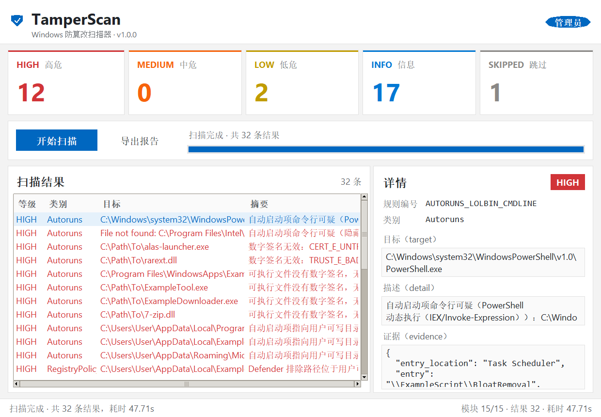
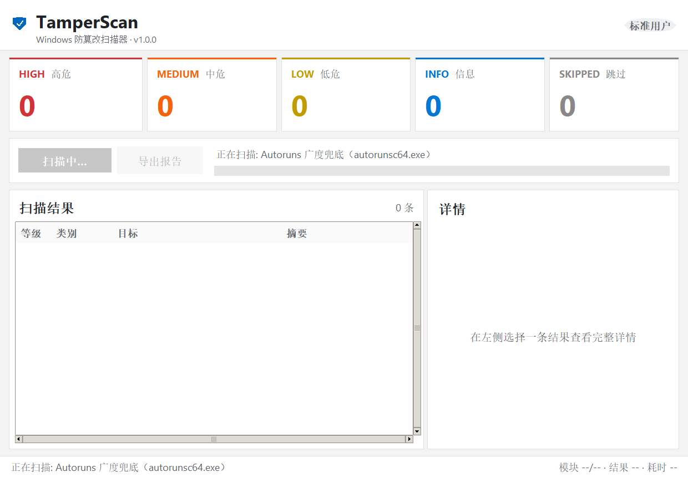

# TamperScan

[](https://github.com/EnkiduX325/tamper_scan/actions/workflows/ci.yml)
[](LICENSE)

开箱即用的 Windows 防篡改扫描器：直接运行即可扫描持久化位置与浏览器配置，输出按严重等级排序的可疑项报告。不依赖预先建立的基线，判定依据是启发式规则 + 数字签名信任链 + 内容特征 + 行为特征。

> ⚠️ 免责声明：本工具仅用于个人设备或已获得明确授权的安全评估。请勿用于未经授权的扫描。使用者应遵守当地法律法规，作者不对滥用行为承担责任。



- 版本：`1.0.0`（唯一来源：[core/version.py](core/version.py)）
- 支持：Windows 10 / 11（x64），Python 3.10+
- 单次扫描、无云端依赖；外部工具仅 Sysinternals `autorunsc64.exe`（缺失自动降级）

> 外部工具提示（重要）：本仓库不包含 Sysinternals 的 `autorunsc64.exe`（其许可不允许第三方再分发），请按 [tools/README.txt](tools/README.txt) 从微软官方下载后放入 `tools/`。若缺少该工具，Autoruns 模块会自动跳过（`SKIPPED`），扫描继续，其余 14 个模块不受影响。

提供两种使用形态：

- GUI 版 `dist\tamper_scan_gui.exe`：双击即用、无控制台窗口，适合普通用户日常扫描与直观查看结果（图形界面详见 [§2](2-图形界面gui)）。
- CLI 版 `dist\tamper_scan.exe`：适合自动化、计划任务、脚本调度或 CI 流水线，通过退出码判断结果。

---

 1. 快速开始

 方式 A：图形界面（推荐普通用户）

```bat
dist\tamper_scan_gui.exe     :: 双击，或在命令行启动（无控制台窗口）
python gui.py                :: 源码方式启动
```

界面操作：点击「开始扫描」→ 查看左侧结果列表与右侧详情 → 点击「导出报告」保存 HTML/JSON。

 方式 B：命令行（适合自动化 / CI）

```bat
dist\tamper_scan.exe --scan
dist\tamper_scan.exe --scan --format both --output reports\scan
python main.py --scan --quiet --format both --output C:\reports\tamper
```

 方式 C：源码运行

```bat
python -m pip install -r requirements.txt
python main.py --scan        :: CLI
python gui.py                :: GUI
```

> `requirements.txt` 是运行依赖；打包 exe 另需 `python -m pip install -r requirements-build.txt`。
> GUI 无新增依赖：`gui.py` 仅使用 Python 标准库 `tkinter` / `ttk`，`requirements.txt` 保持原样即可。
> `skrapa` 为可选依赖（缺失时内存扫描返回 `SKIPPED / MEMORY_SKIPPED`），默认在 `requirements.txt` 中注释，需要内存扫描时自行 `pip install skrapa`。

 以管理员身份运行可得到完整结果

默认不强制提权（exe 无 UAC manifest，GUI 与 CLI 行为一致），标准用户可以正常使用大部分功能，但以下检查按设计降级为 `SKIPPED`（不是"没问题"）：

| 检查 | 标准用户行为 | 原因 |
|---|---|---|
| 进程内存 YARA（`MEMORY_`） | `SKIPPED / MEMORY_ACCESS_DENIED` | skrapa 读取进程内存前必须启用 `SeDebugPrivilege`，标准用户对任何进程（含自己）都会 `TokenPrivilegeError` |
| BITS 全用户作业（`BITS_`） | `SKIPPED / BITS_ACCESS_DENIED`，自动降级只查当前用户 | `Get-BitsTransfer -AllUsers` 需要管理员 |
| Defender 排除项（`POLICY_`） | `SKIPPED / POLICY_ACCESS_DENIED` | `Windows Defender\Exclusions` 键对标准用户拒绝访问 |

需要完整结果时：

- GUI：右键 `tamper_scan_gui.exe` → 以管理员身份运行；
- CLI：以管理员身份打开终端，再执行 `python main.py --scan` 或 `dist\tamper_scan.exe --scan`。

权限降级与界面提示详见 [§2.2](22-权限提醒与降级说明)。

---

 2. 图形界面（GUI）

`gui.py` 是 tkinter + ttk 实现的 Windows 11 Fluent 风格界面（浅灰背景、白色卡片、强调色 `0067C0`、Segoe UI），扫描核心与 CLI 完全复用 [core/scanner.py](core/scanner.py)，因此两种形态的模块顺序、白名单、去重排序、异常降级结果完全一致。

 2.1 两种形态对比

| 维度 | GUI 版 `tamper_scan_gui.exe` | CLI 版 `tamper_scan.exe` |
|---|---|---|
| 启动方式 | 双击即用（`--windowed`，无控制台窗口） | 终端 / 计划任务 / CI 脚本 |
| 结果展示 | 五色统计卡片 + 结果表格 + 详情面板 + 进度条 | 控制台逐条打印 + JSON/HTML 报告文件 |
| 自动化 | 不适合（交互式） | 适合：`--quiet` + 退出码 `2/1/0` |
| 报告导出 | 界面按钮导出 HTML/JSON（文件对话框） | `--format json\|html\|both --output PATH` |
| 典型用户 | 普通用户日常巡检、人工确认 | 运维/安全团队批量调度 |
| 权限完整度 | 取决于是否以管理员身份运行（见 2.2） | 同左 |

 2.2 权限提醒与降级说明

以管理员身份运行可获得最完整的结果：Defender 排除项、BITS 全用户作业、进程内存扫描（`MEMORY_`）都需要管理员权限。

标准用户（未提权）时，以下三类检查会降级为 `SKIPPED`：

| 降级项 | 典型 rule_id | 界面表现 | 说明 |
|---|---|---|---|
| 进程内存 YARA | `MEMORY_ACCESS_DENIED` / `MEMORY_SKIPPED` | 灰色 `SKIPPED` 行 + 灰色统计卡片计数 | skrapa 需 `SeDebugPrivilege` |
| BITS 全用户作业 | `BITS_ACCESS_DENIED` | 灰色 `SKIPPED` 行 | 自动降级只查当前用户 |
| Defender 排除项 | `POLICY_ACCESS_DENIED` | 灰色 `SKIPPED` 行 | 注册表排除项键需要管理员 |

> 这不是报错，也不是“安全”：`SKIPPED` 是权限不足时的安全降级——扫描器明确告诉你“这一项没有检查”，而不是把未检查项当作干净。灰色统计卡片/灰色结果行就是为此设计的提示，导出报告时会原样保留（HTML 报告同样按灰色展示）。

 2.3 界面功能速览

- 五色统计卡片（顶部）：HIGH 红、MEDIUM 橙、LOW 黄、INFO 蓝、SKIPPED 灰，数字为本次扫描各等级结果数；SKIPPED 卡片 > 0 时提示存在未检查项。
- 左侧结果列表：按严重等级排序，行文字与等级同色；列为「等级 / 类别 / 目标 / 摘要」，点击任意行在右侧查看完整详情。
- 右侧详情面板：等级徽章、规则编号、类别、`target`、`detail`，以及可滚动的结构化 `evidence`（签名结果、PE 元数据、命中规则、攻击链等原始证据），便于人工确认。
- 工具栏：「开始扫描」在扫描期间禁用并显示实时进度与当前模块名；「导出报告」复用 [reporter.py](reporter.py) 生成自包含 HTML 或 JSON（原生保存对话框，取消不会报错）。
- 底部状态栏：当前状态、可用模块数、结果数、耗时；扫描在后台线程执行，界面全程可响应、不“未响应”。



 2.4 打包指南

`build.bat` 一次生成两个 exe（先清理 `build/` 与 `dist/`）：

| 产物 | 子系统 | 说明 |
|---|---|---|
| `dist\tamper_scan.exe` | CONSOLE | CLI，保留控制台输出与退出码 |
| `dist\tamper_scan_gui.exe` | WINDOWS_GUI | GUI，基于 `gui.py`，双击不弹控制台 |

```bat
:: 1) 安装构建依赖（仅构建时需要 PyInstaller）
python -m pip install -r requirements-build.txt

:: 2) 一键打包两个 exe
build.bat
```

- 两个 exe 共享同一套打包参数：`--add-data "rules;rules" --add-data "tools;tools"`、`--collect-submodules modules`、`--collect-binaries yara`、`--hidden-import skrapa.windows / win32com.client / pythoncom / pywintypes`（漏掉任何一个都会让 GUI exe 在扫描时静默失败）；
- GUI 仅额外增加 `--windowed`（并改 `--name tamper_scan_gui`）：它让进程使用 Windows GUI 子系统，双击不闪控制台；
- GUI 内部调用 `autorunsc64.exe` / `powershell.exe` 时统一使用 `CREATE_NO_WINDOW` + `SW_HIDE`（`core/utils.py::hidden_process_options` 集中处理），扫描时不会闪黑框；
- 若存在 `icon.ico`，`build.bat` 会自动加 `--icon icon.ico` 嵌入盾牌图标；
- `tools/autorunsc64.exe` 不随仓库分发（[Sysinternals 许可说明](https://learn.microsoft.com/en-us/sysinternals/license-faq)）；本地构建前请按 [tools/README.txt](tools/README.txt) 从微软官方下载，或直接使用无 Autoruns 的降级模式；
- 打包细节（onefile/`_MEIPASS`/模块收集）与测试局限见 [§8](8-构建与打包)。

---

 3. 命令行参数

| 参数 | 说明 |
|---|---|
| `--scan` | 执行一次完整扫描（不带 `--scan` 只打印帮助） |
| `--output PATH` | 报告输出路径（基名；传目录时写入该目录下 `tamper_scan_report`；自动补 `.json/.html`） |
| `--format json\|html\|both` | 报告格式；不指定 `--output` 时写到当前目录 `tamper_scan_report.` |
| `--no-memory` | 跳过进程内存扫描（`lolbin_process` 内存部分 → `MEMORY_SKIPPED`） |
| `--max-memory-scan N` | 内存扫描最多进程数（默认 10；负数会被参数校验拒绝） |
| `--quiet` | 只输出统计摘要、退出码与报告路径，不逐条打印 Finding（适合计划任务/CI） |
| `--module NAME` | 只运行指定模块（可重复，调试/验收用） |
| `--verbose, -v` | 输出模块级明细（含跳过原因） |
| `--list-modules` | 列出 15 个扫描模块及接入状态 |
| `--version` | 打印版本 |

示例：

```bat
:: 定时任务场景：安静模式 + 双格式报告
tamper_scan.exe --scan --quiet --format both --output C:\reports\tamper

:: 管理员完整扫描，并限制内存扫描进程数
tamper_scan.exe --scan --format both --output reports\admin_scan --max-memory-scan 5
```

退出码约定（与输出格式、`--quiet` 无关，供调度器使用）：

| 退出码 | 含义 |
|---|---|
| `2` | 存在 `HIGH` Finding |
| `1` | 无 HIGH，但存在 `MEDIUM` |
| `0` | 其余情况（仅 LOW/INFO/SKIPPED 或干净） |

---

 4. 报告格式

 JSON

```json
{
  "tool": "TamperScan",
  "version": "1.0.0",
  "generated_at": "2026-01-01T00:00:00+00:00",
  "host": {"name": "TEST-PC", "os": "Windows-11-...", "is_admin": true, "user": "User"},
  "scan": {
    "duration_seconds": 47.71,
    "modules_total": 15, "modules_available": 15,
    "modules": [{"name": "autoruns", "label": "...", "status": "ok", "count": 21, "error": null}]
  },
  "summary": {"total": 32, "counts": {"HIGH": 12, "MEDIUM": 0, "LOW": 2, "INFO": 17, "SKIPPED": 1}, "exit_code": 2},
  "findings": [
    {
      "severity": "HIGH | MEDIUM | LOW | INFO | SKIPPED",
      "category": "Autoruns",
      "target": "被检查对象（路径/键/任务名/进程）",
      "detail": "中文描述",
      "evidence": {"...": "结构化证据：签名结果、PE 元数据、命中的规则/攻击链等"},
      "rule_id": "SIG_UNSIGNED 等规则编号"
    }
  ]
}
```

- 去重与排序复用 `core/finding.py`：`target + 规则基名`（如 `AUTORUNS_SIG_UNSIGNED` 与 `SIG_UNSIGNED` 同源合并，`evidence.merged_rules` 记录原始 rule_id），排序 HIGH → MEDIUM → LOW → INFO → SKIPPED。
- 白名单命中的条目会降为 INFO（默认 `mode: downgrade`），`evidence.whitelisted=true` 且 `whitelist_match` 记录命中原因。
- GUI 导出的 JSON 与 CLI 生成的 JSON 结构完全一致（同一 `reporter.build_report`）。

 HTML

单文件、自包含（CSS 内联在 `<style>`，无外部资源、无 JS），可直接转发/离线打开。按 severity 着色：

| 等级 | 颜色 | 含义 |
|---|---|---|
| HIGH | 红 | 需要立即处理 |
| MEDIUM | 橙 | 可疑，建议人工确认 |
| LOW | 黄 | 低风险提示/需了解 |
| INFO | 蓝 | 信息（含白名单降级后的记录） |
| SKIPPED | 灰 | 权限/依赖不足未检查（不代表干净） |

模板使用 Jinja2 且 autoescaping 强制开启（无关闭入口、无 `|safe`），攻击者可控字符串（扩展名、命令行、路径）均已转义。

> 本仓库附一份脱敏后的管理员演示报告（主机名/用户名/路径均为示例值）：[reports/sample_report.json](reports/sample_report.json) / [reports/sample_report.html](reports/sample_report.html)。

---

 5. 降噪策略与白名单

白名单文件：[rules/whitelist.json](rules/whitelist.json)；加载失败（JSON 损坏等）会降级为空名单并继续扫描，不会中断。

`mode` 可选：`downgrade`（默认，命中降 INFO）、`filter`（命中丢弃）、`off`（不过滤）。

已启用的降噪项：

1. 厂商伪装结构化豁免 `masquerade_allow`（6 条）：只对 `SIG_PATH_MASQUERADE` 生效，要求 签名者匹配 + 路径前缀匹配 + 签名状态为 `valid` 三个条件同时满足才降 INFO。当前覆盖 SteelSeries / Micro-Star International / NVIDIA，路径限定 `C:\Windows\System32\` 与 `C:\Windows\SysWOW64\`。签名 `invalid`（内容被篡改）、文件出现在 `%TEMP%`/`Downloads` 等路径时不会降级。
2. 扩展 ID 白名单 `extensions`：只按扩展 ID 精确匹配（不做名称子串，防 typosquatting）。`allowlist_by_id` 全放行；`allowlist_by_id_with_max_score` 内评分 ≤ 上限才放行，权限扩张导致评分超限会重新上报（更新劫持信号）。
3. 不降级的项（有意为之）：
   - 用户可写目录的自启动（如 `%APPDATA%` 下的更新器、Startup 目录脚本）：真实风险面，默认 HIGH；
   - 微软自带计划任务使用脚本解释器的 13 条 `TASK_INTERPRETER`：保留 LOW，不过滤（信息完整）；
   - 任何 `SKIPPED`：权限不足是"未检查"，不会因白名单变成 INFO。

---

 6. 已知局限

1. 目录签名兜底依赖本地 catalog 缓存：`verify()` 先验嵌入签名，失败/缺失时用 `CryptCATAdmin` 查本地目录签名（`WTD_CACHE_ONLY_URL_RETRIEVAL`）。完全离线且未缓存 catalog 的机器上，个别系统文件可能被判 `unsigned`。
2. Web Store 哈希比对未实现：不联网核对扩展文件哈希；`verified_contents.json` 只做 `item_id`/`item_version` 一致性，不当作签名来源。
3. 内存扫描需要管理员（见 [§1](以管理员身份运行可得到完整结果)）；且 `skrapa` 扫描耗时与进程内存大小相关，模块内置 60 秒总时间预算，超预算会记录未扫 PID，可用 `--max-memory-scan` 进一步限制。
4. 单次快照：无法捕捉时间维度变化（例如"昨天可信的扩展今天权限扩张"）。扩展模块已把完整权限集合写入 evidence，为后续版本做权限 diff 预留数据。
5. YARA 内存规则可能误报：内存规则要求多个特征组合出现（如 `Assembly.Load` + AMSI 符号），但正常进程内存仍可能命中；命中会以 HIGH `MEM_YARA_HIT` 上报并附进程/规则信息，需人工确认。若确认误报，收紧 `rules/yara/memory_.yar` 的 `condition` 或降低 `meta.confidence`。
6. `autorunsc64.exe` 采集省略 `-h`：哈希列不参与判定，且 `-h` 会把单次采集从约 16s 拉长到约 72s；需要哈希时自行用其他工具对 Finding 目标计算。
7. CRX2 不支持：仅解析 CRX3 头；CRX2 文件会被跳过（不产生误报）。
8. DNS 判定只覆盖 IPv4：IPv6 DNS（运营商地址无法枚举）统一跳过，避免大量误报；Hosts/DNS 指向私网不报。

---

 7. 规则更新（规则 / 白名单 / 权重数据维护）

```
rules/
├── lolbin_rules.json         进程名特征 / 命令行补充特征 / 父进程异常方向（含 T1047、T1204.002 参考）
├── extension_weights.json    扩展权限权重、可选权限半权重、攻击链 bonus、severity_floors、评分阈值
├── whitelist.json            白名单（masquerade_allow / extensions / paths / signers / ...）
└── yara/
    ├── memory_powershell.yar           内存专用（meta.scope = memory）
    ├── memory_dotnet_reflective.yar    内存专用
    └── file_known_persistence.yar      文件专用（meta.scope = file）
```

- 新增 YARA 规则：放进 `rules/yara/`，文件名以 `memory_` 开头的只用于进程内存扫描，其余用于文件扫描；必须写 `meta.scope` 与 `meta.confidence`。`YaraEngine` 逐文件编译，单条规则语法错误只影响该文件并记录到 `engine.errors`。
- 新增 LOLBin/父进程规则：编辑 `rules/lolbin_rules.json`（正则）。父进程异常是"父 → 子"单向规则，宁窄勿宽。
- 调整扩展评分：编辑 `rules/extension_weights.json`（权重/阈值/攻击链/`severity_floors`），无需改代码。
- 新增厂商伪装豁免：在 `whitelist.json` 的 `masquerade_allow` 追加 `{signer_contains, path_prefix, require_signature_status}`，不要用模糊签名或全局路径放行。
- 新增扩展白名单：`extensions.allowlist_by_id`（完全放行）或 `extensions.allowlist_by_id_with_max_score`（评分上限）。

---

 8. 构建与打包

```bat
:: 1) 安装依赖（仅构建时需要 pyinstaller）
python -m pip install -r requirements-build.txt

:: 2) 打包（产物 dist\tamper_scan.exe 与 dist\tamper_scan_gui.exe，均为 onefile）
build.bat
```

`build.bat` 中的关键参数及原因：

| 参数 | 原因 |
|---|---|
| `--onefile` | 单文件分发；运行时解包到 `_MEIPASS`，代码用 `core/utils.get_base_dir()` 兼容 |
| `--add-data "rules;rules"` / `"tools;tools"` | Windows 分隔符是 `;`；规则与外部工具一起打包（CLI/GUI 必须完全一致）。`tools/` 可能仅有 README（本仓库不提交 autorunsc64.exe），打包仍成功，运行时 Autoruns 模块 SKIPPED |
| `--collect-submodules modules` | 15 个扫描模块是 `importlib` 动态导入，PyInstaller 静态分析发现不了 |
| `--collect-binaries yara` | 打包 `libyara.dll` |
| `--hidden-import skrapa.windows` | skrapa 的 Windows 子模块动态加载 |
| `--hidden-import win32com.client / pythoncom / pywintypes` | pywin32 的动态 COM 加载 |
| `--windowed`（仅 GUI） | 使用 Windows GUI 子系统，双击不弹控制台；子进程统一 `CREATE_NO_WINDOW` 隐藏 |
| `--icon icon.ico`（可选） | 存在时自动嵌入盾牌图标 |
| 不加 `--uac-admin` | 标准用户可运行；需要完整结果时由用户自行"以管理员身份运行" |

> `tools/autorunsc64.exe` 不随仓库分发（[Sysinternals 许可说明](https://learn.microsoft.com/en-us/sysinternals/license-faq)）；本地构建前请按 [tools/README.txt](tools/README.txt) 从微软官方下载，或直接使用无 Autoruns 的降级模式。

测试局限：打包后的 exe 在开发机（有 Python）上验证只能证明"exe 能运行且不依赖系统 Python 路径"（验证方法：清空 PATH 中的 Python 目录后运行 `--scan`，15 个模块仍可用）。完全无 Python 环境的验证建议在干净虚拟机或 Windows Sandbox 中复测。已在 Windows 11 + Python 3.10 上完成打包与运行验证（CLI 与 GUI 双 exe）。

---

 9. 项目结构

```
tamper_scan/
├── main.py                   CLI 入口：参数解析、控制台输出、报告落盘、退出码
├── gui.py                    GUI 入口：tkinter/ttk Fluent 界面，复用 core/scanner.py
├── reporter.py               JSON / 自包含 HTML 报告（Jinja2 autoescape）
├── requirements.txt          运行依赖（GUI 无需新增依赖，tkinter 为标准库）
├── requirements-build.txt    打包依赖（含 -r requirements.txt + pyinstaller）
├── build.bat                 一键打包：CLI + GUI 两个 onefile exe
├── icon.ico                  exe 图标（存在时 build.bat 自动 --icon）
├── README.md
├── core/
│   ├── scanner.py            扫描调度核心（CLI/GUI 共用）：模块顺序、进度回调、白名单、去重排序
│   ├── finding.py            Finding 数据结构、去重（规则基名合并）、排序、退出码
│   ├── signature.py          WinVerifyTrust 嵌入签名 + 目录签名兜底、PE 元数据
│   ├── yara_engine.py        YARA 文件扫描 + skrapa 内存扫描封装（含权限降级）
│   ├── utils.py              路径/ACL/命令行/白名单/系统组件启发式/外部命令（隐藏子进程窗口）
│   └── version.py            版本号唯一来源
├── modules/                  15 个扫描模块，均暴露 scan() -> list[Finding]
│   ├── autoruns.py / registry_run.py / registry_policy.py / browser_settings.py / startup_lnk.py
│   ├── scheduled_task.py / service.py / wmi_subscription.py / network.py / bits.py
│   ├── powershell_profile.py / com_hijack.py / lsa_appinit.py
│   ├── browser_ext.py / lolbin_process.py
├── rules/                    规则与白名单（随 exe 打包）
├── tools/                    外部工具目录（不含 autorunsc64.exe；下载说明见 tools/README.txt）
├── docs/screenshots/         界面截图（本 README 引用）
└── reports/
    └── sample_report.json / sample_report.html    脱敏后的管理员演示报告
```

---

 10. 免责声明

本工具为启发式扫描器，Finding 不等于恶意软件，`SKIPPED` 也表示"未检查"而非"安全"。在隔离/授权的环境中使用；对扫描结果中的文件做删除、隔离等处置前，请先人工确认。
